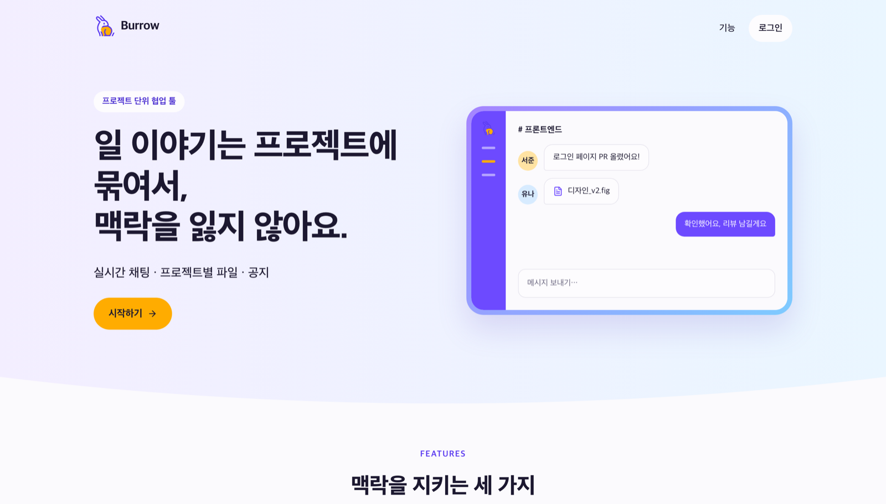
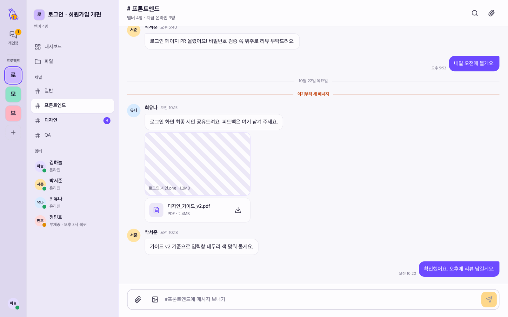
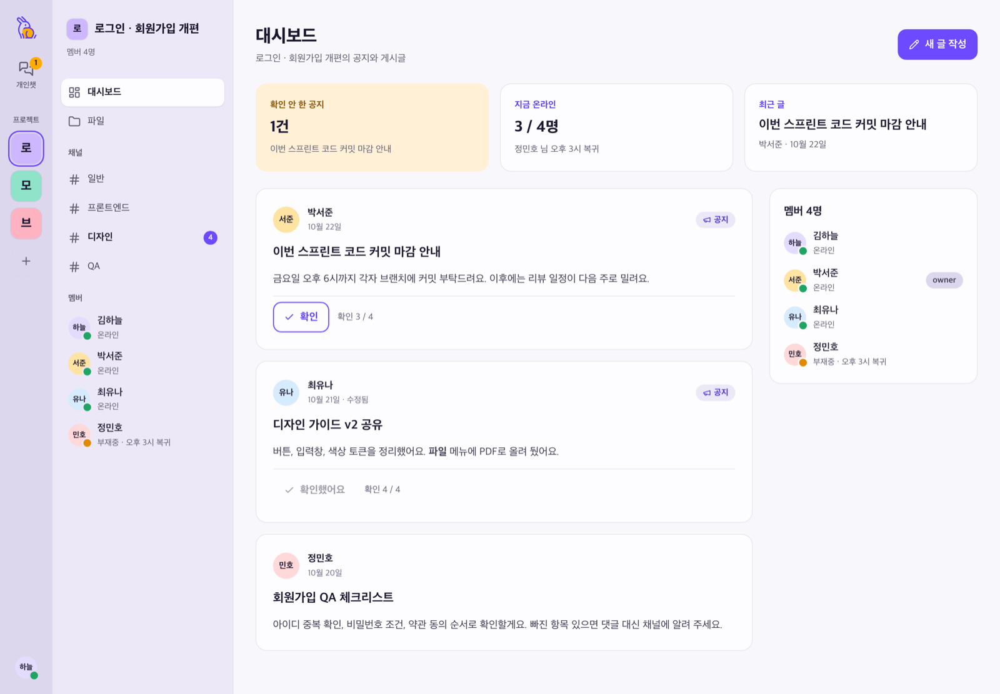
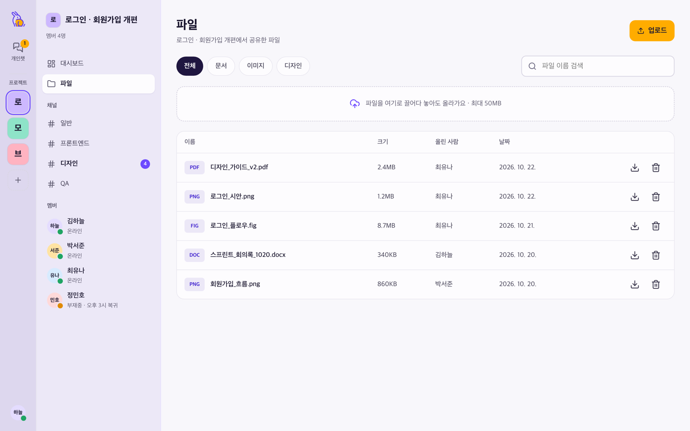
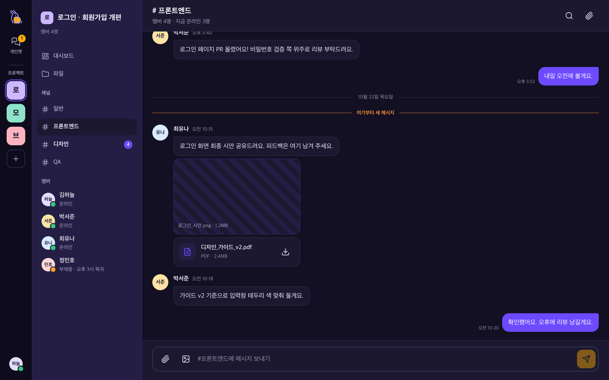

# Burrow 🐰

> **일 이야기는 프로젝트에 묶여서, 맥락을 잃지 않는다.**

대화와 파일을 프로젝트에 소속시키는 실시간 협업 웹 애플리케이션입니다.
토끼굴(burrow)이 여러 방을 하나의 굴로 품듯, 모든 대화를 프로젝트 안에 묶습니다.

> 🚧 **개발 진행 중** (2026.10 ~ 2026.12) — 진행 상황은 아래 [로드맵](#로드맵)에서 확인할 수 있습니다.

<p align="center">
  
</p>

## 배경

Teams로 사람을 초대해 방을 만들어 쓰면서 반복해서 겪은 불편이 있었습니다.

| 불편                                                    | 원인                     |
| ------------------------------------------------------- | ------------------------ |
| 채팅방이 섞이고 이름도 제각각이라 "이게 무슨 방이었지?" | 대화에 **소속이 없다**   |
| 파일도 대화도 항상 **전체**에서 검색해야 한다           | 검색에 범위가 없다       |
| 몇 년 쌓이면 대화 목록 로딩이 느려진다                  | 데이터 누적 시 성능 저하 |

## 해결 방향

```
나
└── 개인챗 (1:1)

프로젝트 ─┬─ 채널 ── 메시지
          ├─ 파일
          └─ 공지·게시글
```

- **프로젝트가 최상위 단위입니다.** 채널·파일·공지는 모두 프로젝트 안에만 존재합니다
- **개인챗은 전역 1:1** 이며, 프로젝트와 다른 급으로 구분해 표시합니다
- 끝난 프로젝트는 **보관**합니다. 보관해도 대화와 파일은 남습니다
- 권한은 owner / member 두 가지로 단순하게 유지합니다

## 화면

> 서버 연결 전이라 목업 데이터로 동작합니다. 화면 컴포넌트는 데이터를 props 로만 받아, 서버가 생기면 데이터를 넣는 자리만 바뀝니다.

<table>
  <tr>
    <td width="50%"></td>
    <td width="50%"></td>
  </tr>
  <tr>
    <td align="center"><sub>채널 채팅 — 레일의 프로젝트 타일 · 안 읽은 메시지 구분선</sub></td>
    <td align="center"><sub>대시보드 — 확인 안 한 공지 · 접속 상태</sub></td>
  </tr>
  <tr>
    <td width="50%"></td>
    <td width="50%"></td>
  </tr>
  <tr>
    <td align="center"><sub>파일 — 프로젝트 단위로 모아 보기</sub></td>
    <td align="center"><sub>다크 모드 — 라이트 / 다크 / 시스템 설정</sub></td>
  </tr>
</table>

## 주요 기능 (MVP)

- 회원가입·로그인
- 프로젝트 생성, 멤버 초대
- 채널 실시간 채팅, 1:1 개인챗
- 프로젝트 단위 파일 공유
- 공지·게시글 대시보드
- 접속 상태(presence) 표시

## 로드맵

실시간 통신이 이 프로젝트의 기술적 중심입니다. Socket.IO 없이 `ws` 로 직접 구현하며,
**연결이 끊기는 상황을 전제로** 단계별로 쌓아 갑니다.

| 단계 | 내용                                              | 상태 |
| ---- | ------------------------------------------------- | ---- |
| 1    | WebSocket 핸드셰이크                              | ⬜   |
| 2    | 방(room) 단위 브로드캐스트                        | ⬜   |
| 3    | 하트비트 · 재연결 · 지수 백오프                   | ⬜   |
| 4    | 접속 상태(presence)                               | ⬜   |
| 5    | `seq` 기반 누락 메시지 복구 (gap recovery)        | ⬜   |
| 6    | optimistic UI · 멱등키(`clientMsgId`)로 중복 방지 | ⬜   |
| 7    | Redis Pub/Sub 수평 확장                           | ⬜   |
| 8    | 보안 (인증 · Origin 검증 · 메시지 스키마 검증)    | ⬜   |

그 밖의 진행 상황

- [x] React Router framework mode → SPA 전환
- [x] 디자인 시스템 적용 · 화면 구성 (테마 전환, 목업 데이터)
- [ ] DB 스키마 · 인증
- [ ] 백엔드 서버 (Fastify + `ws`)

## 기술 스택

| 영역   | 선택                               | 고른 이유                                                        |
| ------ | ---------------------------------- | ---------------------------------------------------------------- |
| UI     | React 19 · TypeScript (strict)     | 타입으로 메시지 스키마와 상태를 안전하게 다룬다                  |
| 라우팅 | React Router v8 (declarative mode) | 백엔드를 분리한 SPA 구조에 서버 렌더링이 필요 없다               |
| 빌드   | Vite 8                             | 빠른 개발 서버, tsconfig paths 네이티브 지원                     |
| 스타일 | vanilla-extract                    | 디자인 토큰을 타입으로 관리하고, 런타임 비용 없이 CSS를 생성한다 |
| 실시간 | `ws` (예정)                        | 라이브러리가 숨기는 재연결·복구를 직접 다루기 위해               |
| 서버   | Fastify (예정)                     | 로깅·스키마 검증이 기본 제공되어 실무형 서버 구성에 적합하다     |
| DB     | PostgreSQL · Prisma (예정)         | 메시지 순서(`seq`)와 커서 페이지네이션에 관계형 DB가 적합하다    |
| 품질   | Vitest · ESLint · Prettier · husky | 커밋·푸시 시점에 검사를 자동화하고, CI 에서 같은 명령을 실행한다 |

각 선택의 대안 비교와 근거는 [기술 결정 기록(ADR)](docs/adr/)에 정리했습니다.

## 실행 방법

**요구사항**: Node 22.22.0 (`.nvmrc` 에 고정되어 있어 `nvm use` 로 맞출 수 있습니다)

```sh
npm install
npm run dev        # http://localhost:5173
```

| 명령             | 설명                                          |
| ---------------- | --------------------------------------------- |
| `npm run build`  | 정적 빌드 (`build/`)                          |
| `npm start`      | 빌드 결과 미리보기                            |
| `npm test`       | 테스트                                        |
| `npm run verify` | 타입 검사 · 린트 · 포맷 · 테스트 (CI 와 동일) |

## 브랜치 전략

- `develop` — 개발 통합 브랜치 (기본 브랜치)
- `feat/...` — 기능 단위로 `develop` 에서 분기
- `main` — 릴리즈 전용, 머지 시 태그(`v0.1.0` …)를 붙입니다
