# CI/CD 입문 — 개념부터 이 프로젝트 설정까지

> 사전 지식 없이 읽을 수 있게 썼다. **그림 → 예시 → 이 프로젝트의 실제 설정** 순서.
> (아래 다이어그램은 GitHub·VS Code에서 그림으로 보인다)
>
> 📌 **용어 표기 규칙**: 실무에서 쓰는 용어는 **굵게 + 원어**로 표기한다
> (예: **merge hell**, **fail fast**). 한국 개발 현장에서도 영어 그대로 쓰는 말이 많아서,
> 번역어보다 원어를 아는 게 실제 대화에 도움이 된다. 8절에 전체 용어집이 있다.

## 1. CI/CD가 무엇인가

두 개의 다른 것이 붙어 있는 용어다. 먼저 분리해서 보자.

---

### CI — Continuous Integration (지속적 통합)

**한 줄 정의**: 코드를 합칠 때마다 **자동으로 검사**하는 것.

무엇을 "통합"하나? 내 브랜치를 `main`에 합치는 것(integration)이다. "지속적"은 **자주**라는 뜻이다.

#### CI가 없던 시절 — 그림으로

각자 몇 주씩 따로 개발하다 한 번에 합친다:

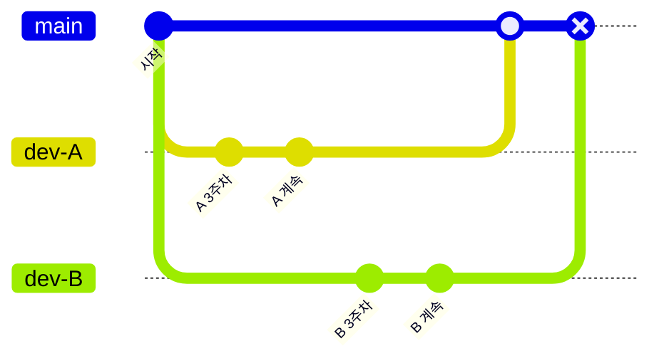

마지막 머지에서 터진다. 각 문제에는 **실제로 쓰는 이름이 있다**:

| 실무 용어                                      | 뜻                       | 왜 생기나                                                   |
| ---------------------------------------------- | ------------------------ | ----------------------------------------------------------- |
| 💥 **merge hell**<br/>(= **integration hell**) | 머지 지옥                | 3주간 쌓인 변경이 한꺼번에 부딪힌다                         |
| 🌴 **long-lived branch**                       | 오래 사는 브랜치         | 브랜치가 길게 살면 `main`과 멀어진다. merge hell의 **원인** |
| 📉 **drift**                                   | 표류                     | 내 브랜치와 `main`이 점점 달라지는 현상                     |
| 🔍 **regression**의 범인 추적 실패             | 되돌아간 버그            | 수백 커밋 중 어느 것이 깨뜨렸는지 모른다                    |
| 🤷 **"works on my machine"**                   | "제 컴퓨터에선 되는데요" | 환경 차이를 아무도 검증하지 않았다                          |

> **"works on my machine"** 은 개발자들이 자기비하 농담으로 쓰는 유명한 표현이다.
> 스티커·티셔츠로도 팔린다. 이 농담을 없애는 게 CI의 존재 이유 중 하나다.

#### CI가 있으면

**작게, 자주 합치고, 합칠 때마다 기계가 검사한다.**

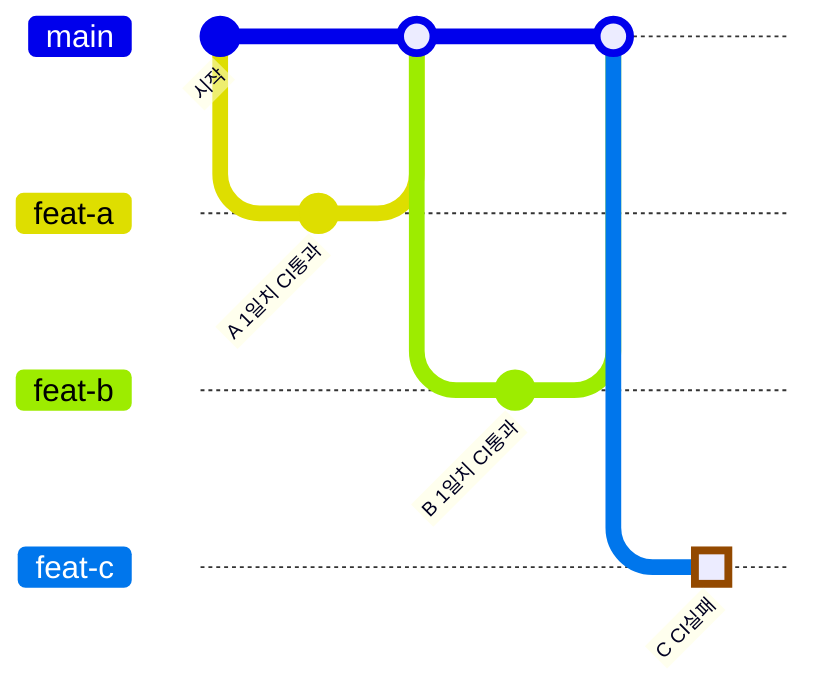

`feat-c`가 실패한 지점이 핵심이다:

- 의심할 코드가 **"방금 그 1일치"로 좁혀진다** → **blast radius**(영향 범위)가 작다
- `main`은 **깨지지 않았다** (머지 전에 막혔으므로) → **main is always green**

이 방식의 실무 용어:

| 용어                        | 뜻                                                                                                       |
| --------------------------- | -------------------------------------------------------------------------------------------------------- |
| **short-lived branch**      | 짧게 사는 브랜치 (1~3일). long-lived branch의 반대                                                       |
| **trunk-based development** | `main`(trunk) 중심으로 짧은 브랜치만 쓰는 전략                                                           |
| **blast radius**            | 변경의 영향 범위. "폭발 반경"이라는 비유                                                                 |
| **main is always green**    | `main`은 항상 CI 통과 상태를 유지한다는 원칙                                                             |
| **shift left**              | 문제를 **개발 흐름의 앞쪽**에서 잡는다는 개념.<br/>왼쪽(개발) ← 오른쪽(운영) 축에서 왼쪽으로 옮긴다는 뜻 |

**shift left**는 특히 자주 쓰인다. "버그를 운영에서 발견하면 100배 비싸니
개발 단계에서 잡자"는 사고방식이고, CI·린트·타입검사·TDD가 모두 shift left의 수단이다.

---

### CD — 두 가지 뜻이 있다 (흔한 혼동)

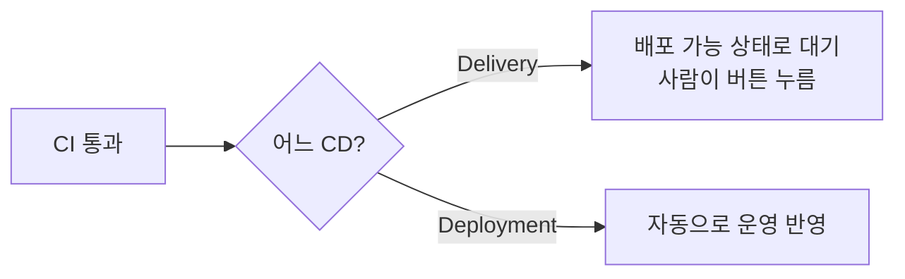

| 용어                             | 뜻                                 | 배포 시점     |
| -------------------------------- | ---------------------------------- | ------------- |
| Continuous **Delivery** (제공)   | 언제든 배포 **가능한 상태**로 유지 | **수동** 승인 |
| Continuous **Deployment** (배포) | 머지되면 **자동** 운영 반영        | 자동          |

둘 다 "CD"로 줄여 쓰므로 면접에서는 구분해 답하는 게 좋다.
대부분의 회사는 **Delivery**(수동 승인)를 쓴다. 자동 배포는 테스트 신뢰도가 아주 높아야 가능하다.

---

### 전체 그림

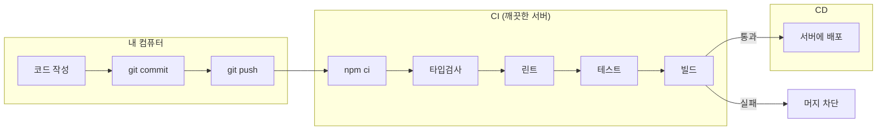

---

## 2. 왜 로컬 검사만으로는 부족한가

"푸시 전에 `npm run verify` 돌리면 되지 않나?" — 맞다. 그래서 git hook도 쓴다. 그런데도 CI가 필요한 이유:

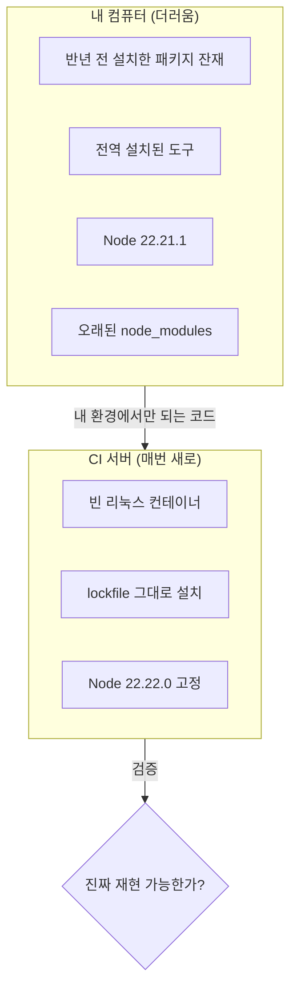

| 로컬 검사의 한계                | CI가 해결하는 방식                   |
| ------------------------------- | ------------------------------------ |
| 깜빡하거나 `--no-verify`로 우회 | 우회 불가. 서버에서 강제             |
| 내 컴퓨터 환경에 의존           | 매번 **깨끗한 환경**에서 처음부터    |
| `node_modules`가 오래돼도 모름  | `npm ci`로 lockfile 그대로 새로 설치 |
| 다른 사람 코드는 검사 못 함     | 모든 PR을 검사                       |

**핵심은 "깨끗한 환경"이다.** 이 차이가 "제 컴퓨터에선 되는데요"를 없앤다.

---

## 3. `npm ci` vs `npm install` — 실제 예시로

CI 설정에서 `npm ci`를 쓴 이유. 면접에서도 자주 나온다.

#### 실제로 벌어지는 일

`package.json`에 `"react": "^19.3.0"`이 있고, lockfile에는 `19.3.0`이 박혀 있다.
그런데 그 사이 React 19.4.0이 나왔다면:

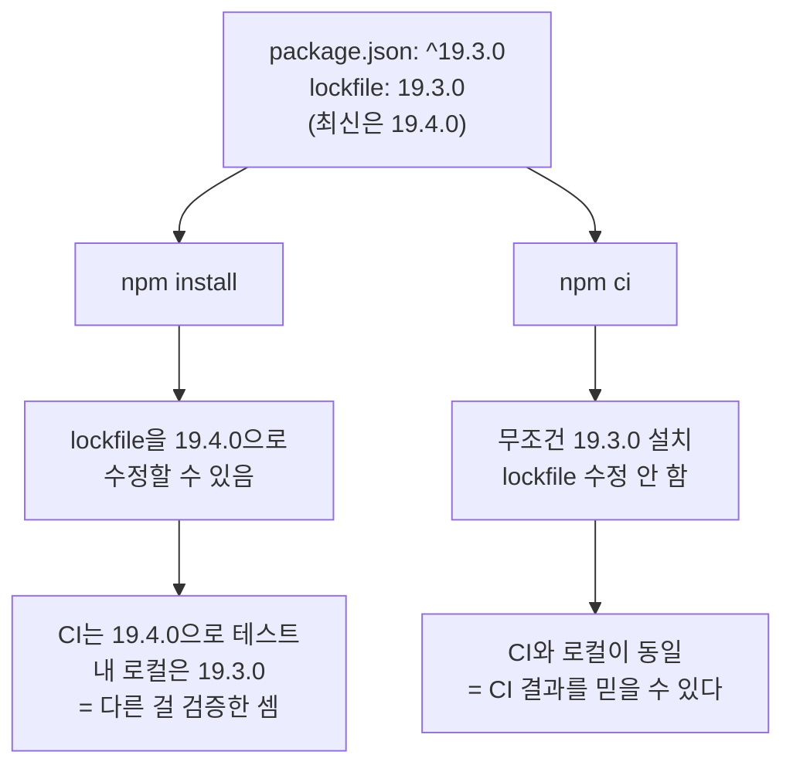

|                    | `npm install`             | `npm ci`                     |
| ------------------ | ------------------------- | ---------------------------- |
| lockfile           | 조건에 따라 **수정 가능** | **절대 수정 안 함**          |
| `node_modules`     | 기존 것 보고 증분 설치    | **지우고 처음부터**          |
| lockfile 불일치 시 | 알아서 해결               | **에러로 중단** ← 좋은 것    |
| 속도               | 상황에 따라               | 보통 빠름 (의존성 해석 생략) |

> `ci`는 "continuous integration"이 아니라 **"clean install"**로 기억하면 쉽다.

**오늘 실제로 겪은 사례**: React Router v8 마이그레이션 때 lockfile이 구 `@remix-run` 트리를
고정하고 있어서 `npm install`이 ERESOLVE로 실패했다. 만약 `--legacy-peer-deps`로 덮었다면
한 트리에 두 버전이 공존해 **런타임에 터졌을 것이다.** lockfile을 재생성한 이유다.
→ [ADR-0001](decisions/0001-remix-v2-to-react-router-v8.md)

---

## 4. 이 프로젝트의 CI 설정 해부

`.github/workflows/ci.yml`을 한 줄씩 본다.

```yaml
name: CI
```

GitHub Actions 화면에 표시될 이름.

```yaml
on:
  push:
    branches: [main]
  pull_request:
```

**언제 실행할지(트리거).** `pull_request`가 실제로 가장 중요하다:

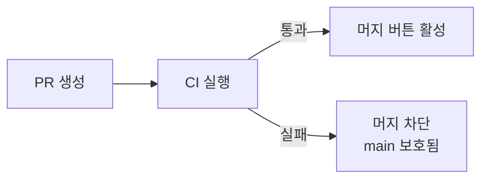

`main` 푸시만 검사하면 **이미 깨진 뒤**에 알게 된다. PR에서 돌아야 머지 전에 잡는다.

```yaml
jobs:
  verify:
    runs-on: ubuntu-latest
```

`job`은 작업 단위, `runs-on`은 OS. Ubuntu를 쓰는 이유: 가장 빠르고 저렴하며 대부분의 서버가 리눅스다.

```yaml
- uses: actions/checkout@v4
```

**내 코드를 가져온다.** 이게 없으면 빈 디렉터리에서 시작한다.
`uses`는 남이 만든 액션 재사용 문법이고 `@v4`로 버전을 고정한다.

```yaml
- uses: actions/setup-node@v4
  with:
    node-version: '22.22.0'
    cache: npm
```

Node를 설치한다. 버전을 **명시적으로 고정**한 이유: React Router 8이 Node > 22.22.0을
요구하므로 로컬과 CI가 같은 버전을 쓰게 한다.

`cache: npm`은 의존성 캐싱이다. 효과:

|               | 캐시 없음                    | 캐시 있음      |
| ------------- | ---------------------------- | -------------- |
| `npm ci` 시간 | ~60초 (수백 패키지 다운로드) | ~10초 (재사용) |

`package-lock.json`이 바뀌면 캐시가 자동으로 무효화된다.

```yaml
- run: npm ci
- run: npm run verify
- run: npm run build
```

`verify` 하나에 typecheck·lint·format·test가 다 들어 있다.
**`package.json`에 `verify` 스크립트를 만든 이유가 이것이다** — CI와 로컬이 완전히 같은 명령을 쓰게 하려고.

```sh
# 로컬에서 CI와 똑같이 검사
npm run verify
```

`build`를 따로 돌리는 이유: **타입이 맞아도 빌드는 깨질 수 있다**
(번들러 설정 문제, 서버 전용 코드가 클라이언트 번들에 섞이는 등).

#### 순서가 왜 이런가 — fail fast

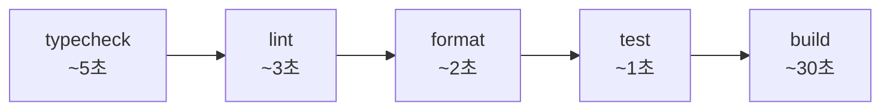

**빠르고 흔히 실패하는 것을 앞에** 둔다. 30초 빌드를 기다린 끝에 세미콜론 때문에 실패하면 시간 낭비다.
이 원칙을 **fail fast**라고 한다.

---

## 5. 로컬 hook과 CI의 역할 분담

같은 검사를 세 군데서 하지만 **범위와 비용이 다르다.** 설계된 분업이다.

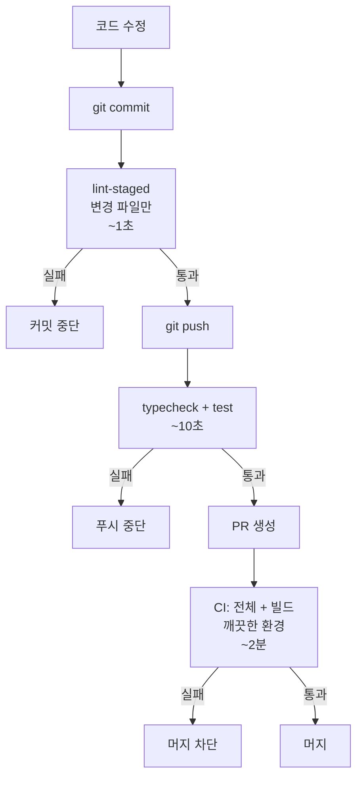

| 시점         | 검사                      | 속도  | 목적                       |
| ------------ | ------------------------- | ----- | -------------------------- |
| `git commit` | lint-staged (변경 파일만) | ~1초  | 사소한 실수 즉시 차단      |
| `git push`   | typecheck + test          | ~10초 | 깨진 코드의 원격 유입 방지 |
| PR (CI)      | 전체 + 빌드, 깨끗한 환경  | ~2분  | 최종 관문. 우회 불가       |

**왜 pre-commit에 테스트를 넣지 않나**: 커밋이 느려지면 사람이 hook을 끈다.
꺼진 hook은 없는 hook이다. 그래서 **단계별로 비용을 나눈다.**

이 구조의 실무 용어:

| 용어                           | 뜻                                                      |
| ------------------------------ | ------------------------------------------------------- |
| **quality gate**               | 품질 관문. 통과하지 못하면 다음 단계로 못 간다          |
| **pre-commit / pre-push hook** | git이 특정 시점에 자동 실행하는 스크립트                |
| **feedback loop**              | 실수 → 발견까지의 시간. **짧을수록 좋다**               |
| **guardrail**                  | 가드레일. 실수를 막는 자동 장치 (hook, CI, 타입 시스템) |
| **toil**                       | 반복적 수작업. 자동화로 없애야 하는 대상 (SRE 용어)     |

**feedback loop**가 핵심 개념이다. 같은 실수를 언제 발견하는지에 따라 비용이 다르다:

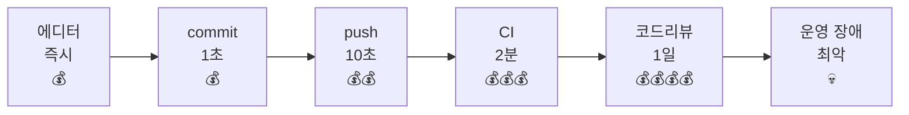

왼쪽에서 잡을수록 싸다. 이것이 **shift left**의 실제 의미다.

#### 실제 출력 예시

오늘 커밋했을 때 실제로 나온 것:

```
⋯ Running tasks for staged files…
    *.{ts,tsx} — 10 files
      ✔ eslint --fix
      ✔ prettier --write
    *.{json,md,css} — 13 files
      ✔ prettier --write
✔ Done running tasks for staged files!
```

**23개 파일 중 변경된 것만** 검사했다. 전체를 돌리지 않는 게 lint-staged의 요점이다.

---

## 6. CD — 배포 (아직 설정하지 않음)

지금은 CI만 있다. 배포는 **배포할 곳을 정한 뒤** 설정한다.

### 이 프로젝트의 배포 제약 (중요)

React Router SSR + **WebSocket 서버**를 쓰므로 호스팅 선택이 제한된다.

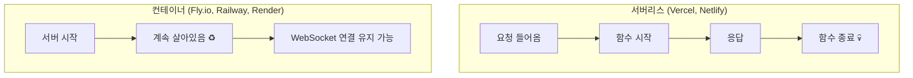

**서버리스에서 WebSocket이 안 되는 이유**: 함수는 요청 하나를 처리하고 **사라진다**(수 초~수 분).
WebSocket은 몇 시간 유지되는 연결이므로 모델이 맞지 않는다.

| 환경                      | SSR | WebSocket | 비고           |
| ------------------------- | --- | --------- | -------------- |
| Vercel / Netlify          | ✅  | ❌        | 장기 연결 불가 |
| Fly.io / Railway / Render | ✅  | ✅        | **후보**       |
| VPS 직접 운영             | ✅  | ✅        | 학습량 최대    |

이 제약을 이해하는 것 자체가 학습 포인트다. 8주차 Redis 수평 확장에서
"왜 연결 상태를 외부에 둬야 하나"와 직접 연결된다.

### 배포 설정 시 다룰 개념 (추후)

| 개념               | 내용                                                              |
| ------------------ | ----------------------------------------------------------------- |
| 환경 변수 / 시크릿 | DB 비밀번호를 코드에 넣지 않고 주입 (GitHub Secrets)              |
| artifact           | 빌드 결과를 다음 단계로 전달                                      |
| 헬스체크           | 배포된 서버가 살아 있는지 확인                                    |
| 롤백               | 배포 실패 시 되돌리기                                             |
| **무중단 배포**    | **연결된 WebSocket 클라이언트를 어떻게?** ← 이 프로젝트 고유 난점 |

마지막 항목이 특히 값지다. 배포하면 서버가 재시작되므로 **모든 WebSocket 연결이 끊긴다.**
3주차에 만든 재연결 로직이 여기서 효과를 발휘한다 — 사용자는 깜빡임만 느끼고 복구된다.

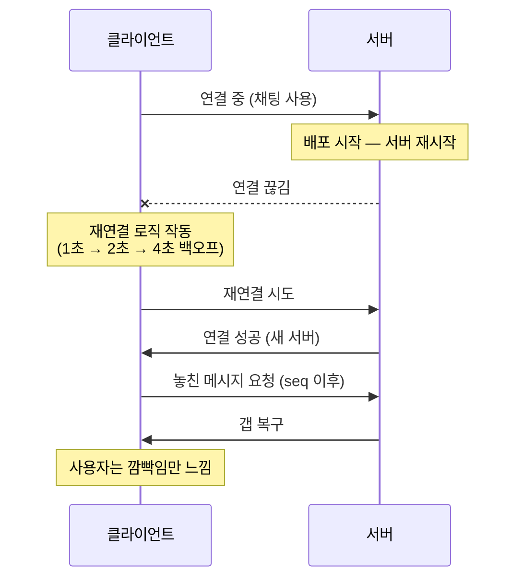

---

## 7. 지금 해볼 것

CI는 **GitHub에 푸시해야 실제로 돌아간다.**

```sh
# 1. GitHub 저장소 생성 (gh CLI 사용)
gh repo create team-manage-service --private --source=. --remote=origin

# 2. 현재 브랜치 푸시
git push -u origin chore/react-router-v8-and-tooling

# 3. PR 생성 → CI 자동 실행
gh pr create --fill

# 4. CI 결과 확인
gh pr checks
```

#### branch protection 설정 (추천)

GitHub 저장소 → Settings → Branches → `main` 규칙 추가:

| 설정                                  | 효과                              |
| ------------------------------------- | --------------------------------- |
| Require status checks to pass         | **CI 실패 시 머지 버튼이 잠긴다** |
| Require a pull request before merging | `main` 직접 푸시 차단             |

혼자 하는 프로젝트에도 켜두길 권한다. **규칙을 기계에 맡기는 연습**이고,
실무에서는 당연히 설정되어 있다. 의지력에 의존하는 규칙은 지켜지지 않는다.

---

## 8. 용어집

실무·면접에서 그대로 쓰는 용어들. **한국 개발 현장에서도 영어로 말하는 경우가 많다.**

### CI/CD 구성 요소

| 용어             | 뜻                                                                           |
| ---------------- | ---------------------------------------------------------------------------- |
| **pipeline**     | CI/CD 전체 흐름 (설치→검사→빌드→배포)                                        |
| **workflow**     | GitHub Actions에서 pipeline을 부르는 이름 (`.github/workflows/`)             |
| **job**          | 파이프라인의 작업 단위. 병렬 실행 가능                                       |
| **step**         | job 안의 개별 명령                                                           |
| **runner**       | job을 실행하는 서버. GitHub 제공(**hosted**) 또는 직접 운영(**self-hosted**) |
| **action**       | 재사용 가능한 작업 단위 (`actions/checkout@v4`)                              |
| **artifact**     | 빌드 산출물. job 간 전달 가능                                                |
| **matrix build** | 여러 조건(Node 20/22, Linux/Mac)을 **동시에** 테스트하는 방식                |

### 상태·결과

| 용어               | 뜻                                                                          |
| ------------------ | --------------------------------------------------------------------------- |
| **status check**   | PR에 표시되는 CI 결과 (✅/❌)                                               |
| **green / red**    | CI 통과 / 실패. "main이 red다" = 지금 깨져 있다                             |
| **broken build**   | 빌드가 깨진 상태. 최우선 수정 대상                                          |
| **flaky test**     | 같은 코드인데 **가끔** 실패하는 테스트. CI 신뢰를 망치므로 최우선 제거 대상 |
| **false positive** | 문제가 없는데 실패로 뜨는 것                                                |
| **false negative** | 문제가 있는데 통과로 뜨는 것. 더 위험하다                                   |

### 전략·원칙

| 용어                     | 뜻                                                              |
| ------------------------ | --------------------------------------------------------------- |
| **fail fast**            | 빠른 검사를 앞에 둬 실패를 조기에 터뜨리는 전략                 |
| **shift left**           | 문제를 개발 흐름의 **앞쪽**에서 잡는다. CI·타입·TDD가 모두 수단 |
| **quality gate**         | 품질 관문. 통과 못 하면 다음 단계로 못 간다                     |
| **guardrail**            | 실수를 막는 자동 장치                                           |
| **feedback loop**        | 실수 → 발견까지의 시간. 짧을수록 싸다                           |
| **main is always green** | `main`은 항상 배포 가능 상태를 유지한다는 원칙                  |
| **blast radius**         | 변경의 영향 범위                                                |
| **toil**                 | 자동화로 없애야 할 반복 수작업 (SRE 용어)                       |

### 브랜치·머지

| 용어                                    | 뜻                                                                            |
| --------------------------------------- | ----------------------------------------------------------------------------- |
| **trunk-based development**             | `main`(trunk) 중심 + 짧은 브랜치                                              |
| **Git Flow**                            | `develop`/`release`/`hotfix`를 쓰는 전략. 정기 버전 출시 제품용               |
| **GitHub Flow**                         | trunk-based의 단순 버전 (브랜치 → PR → 머지)                                  |
| **단순화한 Git Flow**                   | `develop` 통합 + `main` 릴리즈, `release`/`hotfix` 없음. **이 프로젝트 채택** |
| **tag**                                 | 특정 커밋에 붙이는 이름(`v0.1.0`). 릴리즈 지점 표시                           |
| **semantic versioning** (semver)        | `major.minor.patch` 버전 규칙                                                 |
| **`--no-ff`** (no fast-forward)         | 머지 커밋을 강제로 남긴다. 릴리즈 지점이 히스토리에 보이도록                  |
| **short/long-lived branch**             | 짧게/오래 사는 브랜치                                                         |
| **merge hell** (= **integration hell**) | 머지 지옥                                                                     |
| **drift**                               | 내 브랜치가 `main`과 점점 달라지는 현상                                       |
| **squash merge**                        | 여러 커밋을 하나로 합쳐 머지. `main` 히스토리를 깔끔하게                      |
| **fast-forward**                        | 분기 없이 포인터만 전진하는 머지                                              |
| **rebase**                              | 내 커밋을 `main` 최신 위로 옮겨 붙이기                                        |
| **branch protection**                   | `main`에 규칙(CI 통과 필수 등)을 강제하는 GitHub 설정                         |
| **CODEOWNERS**                          | 파일별 리뷰 담당자를 지정하는 파일                                            |

### 배포

| 용어                         | 뜻                                                                                                         |
| ---------------------------- | ---------------------------------------------------------------------------------------------------------- |
| **Continuous Delivery**      | 배포 가능 상태 유지, 버튼은 사람이                                                                         |
| **Continuous Deployment**    | 머지되면 자동 배포                                                                                         |
| **blue-green deployment**    | 구/신 버전 두 세트를 띄워두고 트래픽을 한 번에 전환                                                        |
| **canary release**           | 일부 사용자(5%)에게만 먼저 배포해 반응 확인                                                                |
| **rolling update**           | 서버를 몇 대씩 순차 교체                                                                                   |
| **zero-downtime deployment** | 무중단 배포. **WebSocket에서는 특히 어렵다**                                                               |
| **rollback**                 | 배포 실패 시 이전 버전으로 되돌리기                                                                        |
| **health check**             | 서버가 살아 있는지 주기적으로 확인                                                                         |
| **graceful shutdown**        | 서버 종료 시 진행 중 작업을 마무리하고 끄기.<br/>**WebSocket에서는 "연결을 정리하고 끄기"** ← 8주차에 다룸 |
| **smoke test**               | 배포 후 핵심 기능만 빠르게 확인하는 최소 테스트                                                            |
| **환경 분리**                | **dev / staging / production**. staging은 운영과 같은 구성의 리허설 환경                                   |

### 기타 자주 나오는 말

| 용어                    | 뜻                                                                    |
| ----------------------- | --------------------------------------------------------------------- |
| **works on my machine** | "제 컴퓨터에선 되는데요". CI가 없애려는 대상                          |
| **yak shaving**         | 본 작업을 하려다 끝없이 사전 작업에 빠지는 것                         |
| **bikeshedding**        | 본질(원자로)보다 사소한 것(자전거 보관소 색)에 시간 쓰는 것           |
| **technical debt**      | 기술 부채. 빠르게 짠 코드가 나중에 이자처럼 비용을 요구               |
| **boy scout rule**      | "온 곳보다 깨끗하게 떠나라". 건드린 코드는 조금이라도 개선            |
| **dogfooding**          | 자기 제품을 자기가 써보는 것                                          |
| **post-mortem**         | 장애 후 원인·재발 방지를 정리하는 회고. 사람 비난 없이(**blameless**) |
