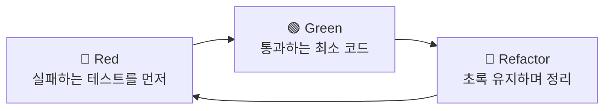
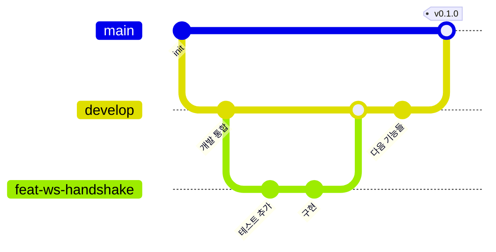

# 작업 방식 (TDD + 브랜치 전략 + 품질 게이트)

실무에 가까운 흐름을 의도적으로 연습하기 위한 규칙. 혼자 하는 프로젝트지만 **팀에서 하듯이** 한다.

## 1. TDD

### 왜 이 프로젝트가 TDD에 특히 맞나

실시간 로직은 **TDD의 교과서적 대상**이다. 이유:

- **순수 함수가 많다** — 백오프 지연 계산, 시퀀스 갭 탐지, 멱등키 중복 제거는
  네트워크도 DOM도 필요 없는 순수 로직이다. 테스트가 쉽다.
- **수동 테스트가 거의 불가능하다** — "재연결 중 메시지 3개 유실"을 손으로 재현하려면
  서버를 죽이고 타이밍을 맞춰야 한다. 테스트로는 1ms면 된다.
- **엣지 케이스가 본질이다** — 실시간의 어려움은 정상 경로가 아니라 경계에 있다.
  경계를 먼저 테스트로 적는 것이 곧 설계다.

### Red → Green → Refactor



| 단계            | 할 일                                                  | 하지 말 것                |
| --------------- | ------------------------------------------------------ | ------------------------- |
| 🔴 **Red**      | 실패하는 테스트를 쓰고 **실행해서 실패를 눈으로 확인** | 구현부터 시작             |
| 🟢 **Green**    | 통과하는 **가장 단순한** 코드                          | 미리 일반화·최적화        |
| 🔧 **Refactor** | 테스트가 초록인 상태를 유지하며 정리                   | 테스트를 빨간 채로 리팩터 |

**Red를 건너뛰지 않는 것이 핵심이다.** 실패를 못 봤다면 그 테스트가 실제로
무언가를 검증하는지 알 수 없다 — 통과만 확인한 테스트가 사실 아무것도 안 하는 경우가 흔하다.
이런 테스트를 **vacuous test**(공허한 테스트)라고 한다.

#### TDD 실무 용어

| 용어                                 | 뜻                                                        |
| ------------------------------------ | --------------------------------------------------------- |
| **red-green-refactor**               | TDD의 기본 사이클                                         |
| **baby steps**                       | 아주 작은 단위로 전진하는 방식                            |
| **YAGNI** (You Aren't Gonna Need It) | 필요해질 때까지 만들지 않는다. Green 단계의 원칙          |
| **test double**                      | 테스트용 대역의 총칭. 아래 5종으로 나뉜다                 |
| **stub**                             | 정해진 값을 반환하는 대역                                 |
| **mock**                             | **호출 여부·횟수를 검증**하는 대역                        |
| **spy**                              | 실제 동작 + 호출 기록                                     |
| **fake**                             | 간단히 동작하는 대체 구현 (예: 인메모리 DB)               |
| **fixture**                          | 테스트용 고정 데이터                                      |
| **SUT** (System Under Test)          | 지금 테스트 대상인 코드                                   |
| **AAA 패턴**                         | **Arrange**(준비) → **Act**(실행) → **Assert**(검증) 구조 |
| **vacuous test**                     | 사실상 아무것도 검증하지 않는 테스트                      |
| **test smell**                       | 테스트 코드의 나쁜 냄새 (중복, 과도한 mock 등)            |
| **regression test**                  | 고친 버그가 다시 생기지 않는지 확인하는 테스트            |

**mock과 stub의 차이**는 면접에서 자주 나온다.
**stub**은 "값을 돌려주는" 대역이고, **mock**은 "불렸는지 검증하는" 대역이다.
`vi.fn()`으로 만든 뒤 `toHaveBeenCalled()`로 확인하면 mock으로 쓴 것이다.

```sh
npm run test:watch   # TDD 중에는 이걸 켜두고 작업한다
```

### 이 프로젝트의 TDD 흐름

빈칸 스캐폴드와 결합한다:

1. Claude가 **테스트를 먼저 준다** (Red 상태) + 함수 시그니처만 있는 빈 구현
2. 테스트를 읽고 **무엇을 만들어야 하는지 파악** ← 여기가 학습 지점
3. 직접 구현해서 Green으로 만든다
4. 리팩터링
5. **스스로 테스트 케이스를 추가한다** ← 여기가 진짜 학습 지점.
   "내가 놓친 엣지 케이스는 뭘까?"

5번을 하면 TDD를 "한" 게 되고, 안 하면 "따라한" 게 된다.

### 무엇을 테스트하고 무엇을 하지 않나

| 테스트한다                   | 하지 않는다                    |
| ---------------------------- | ------------------------------ |
| 백오프 지연 계산 (순수 함수) | WebSocket 라이브러리 자체 동작 |
| 시퀀스 갭 탐지 로직          | React 렌더링 결과 (스냅샷)     |
| 멱등키 중복 제거             | 서드파티 설정값                |
| presence 상태 전이           | CSS                            |
| 메시지 순서 보장             |                                |

**테스트 커버리지 숫자를 목표로 삼지 않는다.** 100%는 실무에서 오히려 나쁜 신호다
(의미 없는 테스트로 숫자를 채웠다는 뜻이기 쉽다). 중요한 건 **위험한 로직이 덮였는지**다.

### 타이머 테스트 (3주차에 바로 필요)

재연결/하트비트는 시간이 관여한다. 실제로 기다리면 테스트가 느려지므로 가짜 타이머를 쓴다:

```ts
import { expect, it, vi } from 'vitest';

it('5초 후 재연결을 시도한다', () => {
  vi.useFakeTimers();
  // ... 연결 끊김 유발
  vi.advanceTimersByTime(5000); // 시간을 "점프"시킨다
  expect(reconnectSpy).toHaveBeenCalled();
  vi.useRealTimers();
});
```

## 2. 브랜치 전략

### 선택: develop 통합 + main 릴리즈 (단순화한 Git Flow)



| 브랜치     | 역할                                                    |
| ---------- | ------------------------------------------------------- |
| `main`     | **릴리즈만.** 동작이 보장된 상태. 머지 시 태그를 붙인다 |
| `develop`  | **개발 통합.** 기능 브랜치가 모이는 곳                  |
| `feat/...` | 기능 단위. **1~3일만 살다가** 사라진다                  |

**왜 이 구조인가:**

- **`main` 이 명함이다.** 저장소를 처음 여는 사람은 `main` 을 본다.
  거기가 항상 "동작하는 상태"인 것에 실제 가치가 있다
- 실시간 작업은 **중간에 깨지는 구간이 생긴다.** 예를 들어 7단계 Redis 수평 확장은
  서버 2대 구성이 전제여서 작업 중에는 로컬에서도 안 돌 수 있다.
  그런 상태를 `main` 에 올리지 않는다
- `main` 머지 시점에 **tag**(`v0.1.0`)를 붙이면 릴리즈 이력이 히스토리에 남는다.
  GitHub **Releases** 페이지로도 보인다

**정식 Git Flow 와의 차이:** `release/`·`hotfix/` 브랜치는 **만들지 않는다.**
여러 버전을 동시 유지보수해야 할 때 필요한 장치인데, 그런 상황이 아니면
의식(**ceremony**)만 남는다. 필요해지면 그때 추가한다.

### 규칙

- `main`·`develop` 에 **직접 커밋하지 않는다.** 항상 기능 브랜치 → PR → 머지
- 기능 브랜치는 **`develop` 에서 분기**하고 `develop` 으로 머지한다
- `main` 으로는 **릴리즈할 때만** 머지하고 **tag** 를 붙인다
  (**semantic versioning**: `v0.1.0` → `v0.2.0` → `v1.0.0`)
- 브랜치는 **짧게 산다** (최대 3일). 길어지면 쪼갠다
- 브랜치명: `<type>/<무엇>` — 예: `feat/ws-handshake`, `fix/presence-leak`
- 머지는 **squash merge**. `develop` 히스토리를 한 기능=한 커밋으로 유지
- 머지 후 브랜치 삭제

### 혼자서도 PR을 쓰는 이유

1. **diff를 리뷰어 시선으로 다시 본다** — 자기 코드의 오류가 PR 화면에서 더 잘 보인다
   (**self-review**)
2. PR 설명을 쓰면서 **"내가 왜 이렇게 했는지"가 정리된다**
3. CI가 PR에서 돌아 `develop`을 지킨다
4. 실무에서 PR 쓰는 습관 그 자체가 연습 대상이다

### 릴리즈 절차

`develop` 이 동작하는 상태에 도달하면:

```sh
# 1. develop 이 깨끗한지 확인
npm run verify && npm run build

# 2. main 으로 머지
git switch main
git merge develop --no-ff      # 머지 커밋을 남긴다 (릴리즈 지점이 보이도록)

# 3. 태그
git tag -a v0.1.0 -m "실시간 채팅 기본 동작"
git push origin main --tags
```

`--no-ff`(no fast-forward)를 쓰는 이유: fast-forward 로 머지하면 **머지 커밋이 안 생겨서**
"언제 릴리즈했는지"가 히스토리에서 사라진다. 릴리즈는 지점이 보여야 한다.

### 커밋 메시지: Conventional Commits

```
<type>(<scope>): <요약>

<본문 — 왜 이렇게 했는지. 무엇을 했는지는 diff에 있다>
```

| type       | 용도                     |
| ---------- | ------------------------ |
| `feat`     | 기능 추가                |
| `fix`      | 버그 수정                |
| `refactor` | 동작 변경 없는 구조 개선 |
| `test`     | 테스트만 추가/수정       |
| `docs`     | 문서                     |
| `chore`    | 빌드·의존성·설정         |
| `perf`     | 성능 개선                |

**본문에는 "왜"를 쓴다.** "무엇"은 diff가 말해준다.
이 습관이 6개월 뒤 자신과 리뷰어를 모두 구한다.

#### 언어: type 은 영어, 제목·본문은 한국어

```
feat(realtime): 지수 백오프 재연결 구현
     ^^^^^^^^   ^^^^^^^^^^^^^^^^^^^^^^
     영어 유지   한국어
```

**`type`(feat/fix/...)과 `scope` 는 영어로 둔다.** Conventional Commits 규약이고,
changelog 생성기·semantic-release 같은 도구가 이 단어를 파싱한다.

**제목과 본문은 한국어로 쓴다.** 특히 본문에 "왜"를 적을 때 모국어가 더 정확하다.
국내 실무에서 흔한 방식이며, 이 저장소는 한국어 사용자가 읽는 것을 전제한다.

예외: 오픈소스에 기여할 때는 그 저장소의 관행을 따른다.

#### AI 공동 작성자 표기는 넣지 않는다

커밋 메시지에 `Co-Authored-By: Claude ...` 같은 줄을 **추가하지 않는다.**
Claude 가 작성한 커밋도 마찬가지다.

#### 예시 — ❌ / ✅ 대조

```
❌ fix: 버그 수정
❌ update code
❌ 작업중
❌ feat: 재연결 로직에 setTimeout 추가하고 delay 변수 만들고 테스트 작성
```

```
✅ fix(realtime): 재연결 시 jitter 누락으로 발생한 thundering herd 완화

   서버 재시작 시 모든 클라이언트가 동일한 지연으로 재연결을 시도해
   부하가 한 시점에 몰렸다. 지연값에 0~30% 무작위 편차를 더해 분산한다.
```

차이: ✅는 **왜**(부하 집중)와 **무엇을 선택했는지**(0~30% jitter)를 말한다.
`setTimeout`을 썼다는 사실은 diff에 있으므로 쓰지 않는다.

#### git·리뷰 실무 용어

| 용어                                | 뜻                                                          |
| ----------------------------------- | ----------------------------------------------------------- |
| **WIP** (Work In Progress)          | 작업 중. PR 제목에 붙이면 "아직 머지하지 마세요"            |
| **draft PR**                        | GitHub의 초안 PR. 머지 불가 상태로 미리 열어 피드백 받기    |
| **LGTM** (Looks Good To Me)         | 승인 의사. 리뷰 댓글로 자주 쓴다                            |
| **nit** (nitpick)                   | 사소한 지적. "nit: 변수명" = 안 고쳐도 머지 가능하다는 신호 |
| **PTAL** (Please Take A Look)       | 리뷰 요청                                                   |
| **blocking / non-blocking comment** | 머지를 막는 지적 / 참고만 하는 지적                         |
| **force push**                      | 히스토리를 덮어쓰는 푸시. 공유 브랜치에서는 **금지**        |
| **cherry-pick**                     | 특정 커밋 하나만 다른 브랜치로 가져오기                     |
| **bisect**                          | 이진 탐색으로 버그를 만든 커밋 찾기 (`git bisect`)          |
| **conventional commits**            | 이 프로젝트가 쓰는 커밋 메시지 규약                         |
| **semantic versioning** (semver)    | `major.minor.patch` 버전 규칙                               |
| **changelog**                       | 버전별 변경 내역 문서                                       |

## 3. 품질 게이트

### 로컬 (git hook이 자동 실행)

| 시점         | 실행                                                      | 왜 거기서                                             |
| ------------ | --------------------------------------------------------- | ----------------------------------------------------- |
| `git commit` | `lint-staged` → 스테이징된 파일만 eslint --fix + prettier | 빠르다. 전체를 돌리면 커밋이 느려져 hook을 끄게 된다  |
| `git push`   | `typecheck` + `test`                                      | 느려도 괜찮은 시점. 깨진 코드가 원격에 가는 걸 막는다 |

hook을 급히 우회해야 하면 `--no-verify`. 단, 왜 우회했는지 기억할 것.

### 전체 검사

```sh
npm run verify   # typecheck + lint + format:check + test
```

CI와 동일한 명령이다. **푸시 전 한 번 돌린다.**

## 4. 명령어 지도

```sh
# 개발
npm run dev            # 개발 서버
npm run test:watch     # TDD 중 상시 실행

# 검사
npm run typecheck      # 타입 (react-router typegen 포함)
npm run lint           # ESLint
npm run format         # Prettier 적용 (쓰기)
npm run format:check   # Prettier 검사 (CI용, 쓰지 않음)
npm test               # 테스트 1회
npm run test:cov       # 커버리지
npm run verify         # 전부 (= CI)

# 빌드
npm run build && npm start
```

## 5. 한 기능의 전체 흐름 (실제 예시)

3주차 "재연결 백오프"를 한다면:

```sh
git switch -c feat/reconnect-backoff     # 1. 브랜치

npm run test:watch                       # 2. watch 켜기
                                         # 3. Red: 실패하는 테스트 확인
                                         # 4. Green: 구현
                                         # 5. Refactor
                                         # 6. 엣지 케이스 테스트 직접 추가

npm run verify                            # 7. 전체 검사
git add -A && git commit                  # 8. hook이 lint-staged 실행
                                          #    feat(realtime): 지수 백오프 재연결 구현
git push -u origin feat/reconnect-backoff # 9. hook이 typecheck+test 실행
gh pr create                              # 10. PR (CI 실행)
                                          # 11. 스스로 diff 리뷰
gh pr merge --squash --delete-branch       # 12. 머지
```

그리고 `docs/decisions/`에 ADR, `docs/PROGRESS.md` 갱신.
