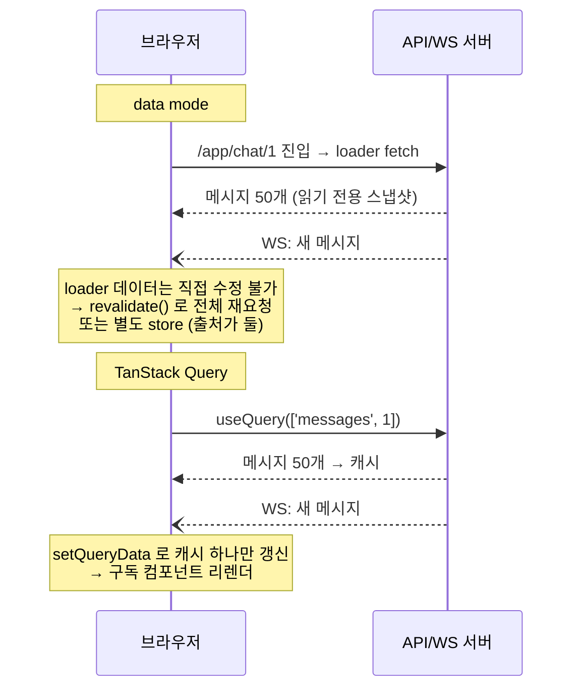

# ADR-0004: React Router framework mode → SPA (declarative mode + TanStack Query)

- **날짜**: 2026-10-22
- **상태**: 완료 (2026-10-22, `feat/spa-migration`)
- **관련**: [ADR-0001](0001-remix-v2-to-react-router-v8.md), [ADR-0003](0003-develop-migration.md) 의 framework mode 를 대체한다

## 배경

Remix v2 로 시작해 React Router v8 framework mode 로 이전했다(ADR-0003).
Remix 는 학습 목적으로 도입했는데, 이 앱의 요구사항과 대조해 보니 맞지 않았다.

| 요구사항                          | framework mode 가 주는 것 | 실제로 필요한가                       |
| --------------------------------- | ------------------------- | ------------------------------------- |
| 로그인 뒤에서만 쓰는 협업 앱      | SSR, SEO                  | ❌ 검색 노출 대상이 없다              |
| 핵심 데이터가 WebSocket 으로 옴   | loader/action (요청-응답) | ❌ push 데이터를 담지 못한다          |
| Quill 등 브라우저 전용 라이브러리 | —                         | SSR 때문에 `ClientOnly` 우회가 생겼다 |

즉 framework mode 의 핵심 가치(SSR, 서버 loader)가 이 앱에서는 **비용만 남는다**.
→ **over-engineering**. SPA 로 전환한다.

남은 질문은 "SPA 에서 React Router 를 어떤 모드로 쓰나"였다.

## 선택지

React Router 는 세 가지 모드를 제공한다.

|                  | framework (현재)           | data mode                    | **declarative (채택)**    |
| ---------------- | -------------------------- | ---------------------------- | ------------------------- |
| 형태             | Vite 플러그인, 파일 라우팅 | `createBrowserRouter([...])` | `<BrowserRouter><Routes>` |
| loader/action    | 서버에서 실행              | 브라우저에서 실행            | 없음                      |
| 서버 데이터 관리 | loader                     | loader                       | **TanStack Query**        |
| 라우트 타입 생성 | typegen                    | 없음                         | 없음 (필요 없음)          |

검토했지만 고르지 않은 것:

- **framework + `ssr: false` (SPA mode)** — 변경량은 가장 적다. 그러나 쓰지 않는 프레임워크 레이어(typegen, 설정 파일, 빌드 플러그인)를 계속 짊어진다
- **data mode + TanStack Query** — loader 가 Query 캐시를 미리 채우는(`ensureQueryData`) 패턴. 진입 전 로딩을 얻지만,
  서버 데이터를 다루는 곳이 둘(loader, Query)이 되어 규칙을 지키지 않으면 **stale data** 가 생긴다. 지금 규모에서는 복잡도만 늘어난다
- **TanStack Router** — 아래 비교 참조

## 결정

**declarative mode + TanStack Query.** 라우터는 URL 매칭만, 서버 상태는 Query 캐시가 담당한다.

### 왜 data mode 가 아닌가 — 실시간과의 궁합

loader 데이터는 **내비게이션 단위 스냅샷**이다. URL 이 그대로인 상태에서 서버가 데이터를 밀어 넣는(**server push**) 채팅과 맞지 않는다.



```ts
// ❌ data mode — push 를 반영하려면 매번 전체 재요청
socket.on('message', () => revalidator.revalidate());

// ✅ Query — 캐시에 직접 반영. single source of truth 유지
socket.on('message', (msg) =>
  queryClient.setQueryData(['messages', roomId], (old) => [...old, msg]),
);
```

**server state** 를 담을 **single source of truth** 가 필요하고, 그 역할에는 loader 보다 Query 캐시가 맞다.

> ⚠️ 정확한 표현: React Router 의 한계는 "push 기능이 없다"가 아니다. **TanStack Query 에도 push 기능은 없다.**
> push 는 WebSocket 이 한다. React Router 의 한계는 **WebSocket 으로 받은 데이터를 넣어 둘 쓰기 가능한 저장소가 없다**는 것이다.

### 왜 `useEffect` fetch 로 버티지 않는가

loader 를 지운 자리를 `useEffect` + `useState` 로 채우면, `:id` 만 바뀌는 이동에서 컴포넌트가 **재사용**되기 때문에
다음을 매 화면마다 직접 처리해야 한다 (마이그레이션 중 대시보드에서 실제로 확인):

| 문제                                          | 수동 처리                                      | TanStack Query                                   |
| --------------------------------------------- | ---------------------------------------------- | ------------------------------------------------ |
| 의존성 누락 → 이전 id 의 **stale data**       | 의존성 배열에 `id`                             | `queryKey: ['dashboard', id]` 가 바뀌면 재요청   |
| 늦게 온 응답이 최신을 덮는 **race condition** | cleanup 의 `ignore` 플래그 / `AbortController` | 결과가 queryKey 별로 저장되어 구조적으로 안 생김 |
| 로딩·에러 상태                                | `useState` 를 더 둔다                          | `isPending`·`error` 제공                         |
| 같은 팀으로 돌아오면 다시 요청                | 별도 캐시 필요                                 | 캐시에서 즉시 표시                               |

화면이 하나일 때는 수동으로도 되지만, 서버 상태를 쓰는 화면마다 같은 처리가 반복된다.

### 왜 TanStack Router 가 아닌가

라이브러리 설계만 보면 TanStack Router 가 앞선다.

|               | React Router (declarative)                   | TanStack Router                                        |
| ------------- | -------------------------------------------- | ------------------------------------------------------ |
| 타입 안전성   | 약함. `useParams()` 가 `string \| undefined` | **강함.** 경로·파라미터·`<Link to>` 오타가 컴파일 에러 |
| search params | `URLSearchParams` 직접 파싱                  | 스키마로 검증된 타입 있는 상태                         |
| Query 연동    | 따로 쓴다                                    | loader 에서 공식 통합                                  |
| 생태계·인지도 | 매우 넓다                                    | 성장 중, 상대적으로 작다                               |
| 학습 비용     | 이미 안다                                    | 새로 배워야 한다                                       |

그래도 React Router 를 고른 이유:

1. **이 프로젝트의 차별점은 라우터가 아니라 실시간이다.** 10주 일정에서 새 라우터 학습은 **opportunity cost** 다
2. **TanStack Router 의 강점을 쓸 일이 적다.** 라우트 11개, 파라미터는 거의 `id` 하나, search params 상태(필터·정렬·페이지)가 없다
3. 리뷰어 대부분이 아는 도구라 설명 비용이 낮다

### 왜 실무 관점에서도 타당한가

"라우터는 URL 매칭, 서버 상태는 TanStack Query" 는 React SPA 에서 가장 흔한 구성이다.
"WebSocket 이벤트로 Query 캐시를 갱신" 하는 것도 널리 쓰이는 패턴이다.

## 결과

### 얻는 것

- 프레임워크 레이어 제거: `react-router.config.ts`, `entry.server.tsx`, typegen, `@react-router/dev`·`serve`·`fs-routes`, `remix-utils`
- 빌드 결과가 **정적 파일**이다 → 어떤 정적 호스팅에도 올릴 수 있다
- 프론트(SPA) / 백엔드(API + WS) 의 **역할 분리**가 명확해진다 → 7단계(Redis 수평 확장)에서 프론트와 무관하게 서버만 늘릴 수 있다

### 잃는 것

- **라우트 진입 전 데이터 로딩** — loader 는 렌더 전에 fetch 를 시작한다.
  declarative 에서는 컴포넌트가 렌더된 뒤 시작된다. 필요하면 `queryClient.prefetchQuery` 로 보완한다
- **`<Form>` 의 progressive enhancement** — JS 없이 동작하는 폼. SPA 에서는 원래 의미가 없다
- 파일 기반 라우팅 → 라우트를 직접 선언해야 한다

### 주의 — 직접 구현할 범위와의 경계

TanStack Query 의 `useMutation` 은 optimistic update 를 돕는다(`onMutate`, rollback).
그러나 아래는 **여전히 직접 구현한다**:

| Query 가 해주는 것                    | 직접 구현하는 것                                      |
| ------------------------------------- | ----------------------------------------------------- |
| 캐시 저장소, 요청 상태(loading/error) | `clientMsgId` 로 서버 echo 와 낙관적 메시지 중복 제거 |
| 재요청, 캐시 무효화                   | `seq` 기반 갭 복구                                    |
| mutation 롤백 훅                      | 재연결 후 캐시 정합성                                 |

### 다시 검토할 조건

- 로그인 전 공개 페이지(랜딩·마케팅)가 커져 SEO 가 필요해지면 → 그 부분만 정적 생성 검토
- 라우트 수가 크게 늘거나 URL 에 담는 상태(필터·정렬·페이지)가 많아지면 → TanStack Router 재검토

## 자주 받는 질문

**Q. React Router 에는 서버 데이터를 가져오는 기능이 없나? 기능 중복 아닌가?**
있다. `loader`·`action` 은 data/framework mode 에서만 동작하고, declarative mode(`<BrowserRouter>`)에서는 붙일 곳이 없다.
즉 한 패키지의 일부 기능을 **의도적으로 쓰지 않는 것**이고, 역할은 겹치지 않는다.
쓰지 않는 코드는 빌드 시 **tree shaking** 으로 대부분 제거된다.

| 구성                           | 서버 데이터 담당 | 중복             |
| ------------------------------ | ---------------- | ---------------- |
| **declarative + Query (채택)** | Query 하나       | 없음             |
| data mode 단독                 | loader 하나      | 없음             |
| data mode + Query              | loader + Query   | 규칙 없으면 있음 |

**Q. 실시간 push 는 TanStack Query 가 해 주나?**
아니다. 역할은 셋으로 나뉜다.

| 역할                          | 담당                  |
| ----------------------------- | --------------------- |
| 데이터를 받아 오는 통로(push) | WebSocket (직접 구현) |
| 받은 데이터를 담아 두는 곳    | TanStack Query 캐시   |
| 어떤 화면을 띄울지            | React Router          |

Zustand 같은 client state 저장소에 담는 방법도 있지만, 그러면 최초 로딩(HTTP)과 갱신(WS)이
서로 다른 저장소로 흩어지기 쉽다. Query 는 둘을 한 캐시에서 처리한다.

**Q. 그럼 React Router 를 빼고 TanStack Query 만 쓰면 되지 않나?**
안 된다. Query 에는 라우팅 기능이 없다. 라우터 없이는 URL 매칭, History API 연동(뒤로 가기),
중첩 레이아웃(`<Outlet>`), `<Link>` 이동, 404 를 직접 만들어야 한다(**reinventing the wheel**).
"TanStack 으로 다 한다"는 TanStack **Router** + Query 조합을 뜻하며, 이것도 라이브러리는 두 개다.

## 요약

> 학습 목적으로 Remix(React Router framework)를 썼지만, 로그인 뒤 협업 앱이라 SSR 이점이 없고
> 핵심 데이터가 WebSocket 으로 와서 loader 의 요청-응답 모델과 맞지 않았습니다.
> 그래서 SPA 로 전환했습니다. data mode 는 loader 데이터가 내비게이션 단위 스냅샷이라
> push 를 반영하기 어려워 기각했고, 서버 상태는 TanStack Query 캐시 하나로 관리합니다.
> 라우트 진입 전 데이터 로딩은 잃었지만, 필요하면 prefetch 로 보완할 수 있습니다.
