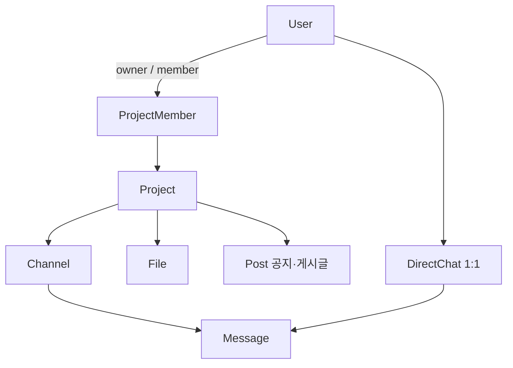

# ADR-0005: 기획 재정의 — "팀" 대신 "프로젝트" 중심, MVP 범위 축소

- **날짜**: 2026-10-22
- **상태**: 결정됨

## 배경

기존 앱은 "팀" 단위(`/app/teams`)에 채팅·대시보드·파일이 붙은 구조였다.
Claude Design 으로 화면 시안을 보완하면서 프로젝트 공간·팀 일정·내 작업·내 일정이 추가됐는데,
**기능의 약 70% 가 AI 가 "Teams 같은 툴이면 있을 법한 것"으로 제안한 것**이었다.
"팀"과 "프론트엔드팀" 같은 예시도 AI 가 넣은 것이었다.

이대로면 "왜 이 기능을 만들었냐"에 답할 수 없고, 다음 작업인 DB 스키마 설계의 전제(도메인 모델)도 정해지지 않는다.
그래서 **직접 겪은 문제**에서 다시 출발했다.

## 결정

1. **중심 문제는 "맥락"** — Teams 에서 방이 섞이고 이름이 제각각이라 "이게 무슨 방이었지?" 하던 경험
2. **최상위 단위는 프로젝트.** "팀"이라는 별도 단위는 없다. 팀 = 그 프로젝트의 멤버
3. **채널은 프로젝트 안에만.** 개인챗은 **1:1 만**, 프로젝트와 다른 급으로 표시
4. **MVP 축소**: 일정·작업 기능, 조직 단위, 세밀한 권한, 프로젝트별 DM, 일이 아닌 단톡방 제외

## 선택지와 이유

### 최상위 단위: 팀 vs 프로젝트 vs 조직

|                | 팀 단위 (기존)        | **프로젝트 단위 (채택)** | 조직 › 프로젝트            |
| -------------- | --------------------- | ------------------------ | -------------------------- |
| 맥락 문제 해결 | 팀 안에서 다시 섞인다 | 일 단위로 묶인다         | 일 단위로 묶인다           |
| 권한           | 한 겹                 | 한 겹                    | **두 겹**(조직 + 프로젝트) |
| 나중에 확장    | —                     | 위에 조직을 얹을 수 있다 | —                          |

### 1:1 대화 위치 — 인터뷰 중 뒤집은 결정

| 안                  | 장점                         | 단점                                          |
| ------------------- | ---------------------------- | --------------------------------------------- |
| 프로젝트별 DM       | 1:1 도 맥락이 보존된다       | 같은 사람과 방이 여러 개 → "어디서 얘기했지?" |
| **전역 1:1 (채택)** | 익숙하다. 사람 기준으로 하나 | 여러 프로젝트 이야기가 섞인다                 |

맥락이 중요한 건 **여러 사람의 대화**다. 1:1 까지 묶으면 맥락보다 복잡도가 더 커진다.

### 잡담 공간 — 범위 밖

"멤버별 기본 라운지"를 검토했지만 **라운지에 누가 있는지**를 정하려면 조직 단위가 필요했다.
잡담을 프로젝트로 만들게 하면 레일에서 업무 프로젝트와 **같은 급**으로 보이는데, 이것이 받아들일 수 없는 지점이었다(개수가 아니라 **위계** 문제).
→ 일이 아닌 단톡방은 MVP 에서 지원하지 않는다.

## 결과

### 얻는 것

- "왜 이 기능?"에 **경험으로** 답할 수 있다
- DB 스키마의 전제가 정해졌다 (User · Project · ProjectMember · Channel · DirectChat · Message · File · Post)
- 실시간에 쓸 시간 확보 — 일정·작업 도메인을 통째로 뺐다
- 불편 3(쌓이면 느림)이 실시간 5단계의 `seq`·커서와 같은 기술(cursor pagination)로 이어진다

### 잃는 것

- 디자인 시안의 일정·작업·내 일정 화면 (후속 작업으로 시안만 남긴다)
- 일이 아닌 단톡방 — 실사용이라면 불편할 수 있다

### 다시 검토할 조건

- 조직 단위가 필요해지면(회사 전체 공지 등) → 조직 + 전체 라운지를 함께 도입
- 1:1 에서 프로젝트 이야기가 섞여 불편하다는 피드백 → 메시지에 프로젝트 태그 같은 가벼운 방법부터

## 요약

> 처음 기능의 상당 부분은 AI 가 제안한 "있을 법한 기능"이었습니다. Teams 를 쓰며 직접 겪은
> "방이 섞여 맥락을 잃는다"는 문제로 다시 출발해 프로젝트를 최상위 단위로 두고, 채널은 프로젝트 안에만,
> 1:1 은 전역으로 정했습니다. 프로젝트별 DM 은 검토했지만 같은 사람과 방이 여러 개 생겨 오히려 복잡해서 뺐고,
> 일정·조직 단위 같은 기능은 핵심 문제와 거리가 멀어 MVP 에서 제외했습니다.
