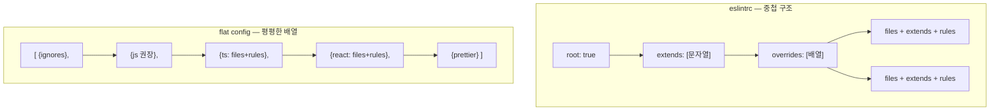
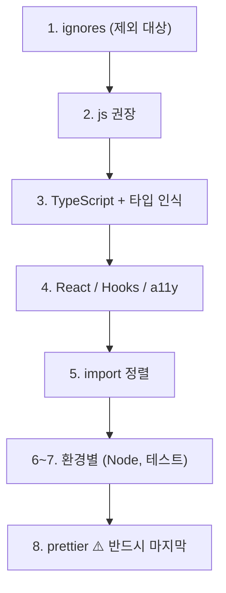

# ESLint flat config — 무엇이 바뀌었나

> 2026-10-13. `.eslintrc.cjs` (eslintrc) → `eslint.config.js` (flat config) 이전 기록.

## 왜 바뀌었나

ESLint 9부터 **flat config가 기본**이다. 기존 eslintrc 방식은 설계상 문제가 있었다:

| eslintrc의 문제                                                            | flat config의 해결                   |
| -------------------------------------------------------------------------- | ------------------------------------ |
| `extends` 문자열이 **어디서 오는지 불투명** (`"plugin:react/recommended"`) | `import` 로 가져온다 — **추적 가능** |
| 설정이 **상위 폴더로 자동 전파**(cascade)돼 예측이 어렵다                  | cascade 없음. 한 파일에 전부 명시    |
| 플러그인 이름 해석 규칙이 암묵적                                           | 객체로 직접 등록                     |
| `.eslintignore` 가 별도 파일                                               | `ignores` 가 설정 안으로             |

핵심 철학은 **"암묵적 마법 제거, 명시적 JS 모듈"** 이다.

## 구조 비교

### 모양이 어떻게 달라지나



**flat config는 "설정 객체의 배열"** 이고, 배열은 **위에서 아래로 병합**된다.
뒤에 오는 것이 앞을 덮으므로 **순서가 의미를 가진다.**

### before / after — 실제 코드

**① 플러그인 등록**

```js
// ❌ before (.eslintrc.cjs) — 문자열. 어느 패키지인지 암묵적
plugins: ["react", "jsx-a11y"],
extends: ["plugin:react/recommended"],
```

```js
// ✅ after (eslint.config.js) — import. 출처가 명확
import react from "eslint-plugin-react";
plugins: { react },
rules: { ...react.configs.flat.recommended.rules },
```

**② 적용 범위**

```js
// ❌ before — overrides 배열 안에 중첩
overrides: [
  { files: ["**/*.{ts,tsx}"], parser: "...", extends: [...] }
]
```

```js
// ✅ after — 최상위 배열의 한 원소. files 로 범위 지정
{ files: ["**/*.{ts,tsx}"], rules: { ... } }
```

**③ 무시할 파일**

```
# ❌ before — .eslintignore 라는 별도 파일
build
node_modules
```

```js
// ✅ after — 설정 안으로
{
  ignores: ['build/**', 'node_modules/**'];
}
```

→ 그래서 `package.json` 의 lint 스크립트에서 **`--ignore-path` 옵션을 제거**했다.
flat config 에서는 그 옵션이 더 이상 필요하지 않다.

**④ 전역 변수 (`env` → `globals`)**

```js
// ❌ before — env 라는 전용 키
env: { browser: true, commonjs: true, es6: true }
```

```js
// ✅ after — globals 패키지에서 가져온다
import globals from "globals";
languageOptions: { globals: { ...globals.browser } }
```

## 이번에 바뀐 패키지

| 이전                                                             | 이후                                  | 왜                                                           |
| ---------------------------------------------------------------- | ------------------------------------- | ------------------------------------------------------------ |
| `@typescript-eslint/eslint-plugin` + `@typescript-eslint/parser` | **`typescript-eslint`** (하나로 통합) | flat config 용 통합 패키지. `tseslint.config()` 헬퍼 제공    |
| `eslint-plugin-import`                                           | **`eslint-plugin-import-x`**          | 원본은 flat config 지원이 느리다. import-x 는 포크로 더 활발 |
| `eslint` 8.57.1                                                  | **9.39.5**                            | 8은 EOL (설치 시 경고가 떴다)                                |
| —                                                                | **`@eslint/js`** (추가)               | 기본 JS 권장 규칙. 이전엔 `"eslint:recommended"` 문자열      |
| —                                                                | **`globals`** (추가)                  | 환경별 전역 변수 목록                                        |
| —                                                                | **`eslint-config-prettier`** (추가)   | 포매팅 규칙 충돌 방지                                        |

### ⚠️ ESLint 10을 쓰지 않은 이유

처음에 10.12.0 을 설치하려다 **ERESOLVE** 로 실패했다.

```
peer eslint@"^3 || ... || ^9" from eslint-plugin-jsx-a11y@6.10.2
```

**플러그인 생태계가 아직 10을 따라오지 못했다:**

| 패키지                      | 지원 ESLint              | 10 가능? |
| --------------------------- | ------------------------ | -------- |
| `eslint-plugin-jsx-a11y`    | `^3 … ^9`                | ❌       |
| `eslint-plugin-react`       | `^3 … ^9.7`              | ❌       |
| `eslint-plugin-react-hooks` | `… ^10`                  | ✅       |
| `typescript-eslint`         | `^8.57 \|\| ^9 \|\| ^10` | ✅       |
| `eslint-plugin-import-x`    | `^8.57 \|\| ^9 \|\| ^10` | ✅       |

`--legacy-peer-deps` 로 강제 설치할 수도 있었지만 **하지 않았다.**
peer 선언을 무시하면 설치는 되지만 플러그인이 ESLint 내부 API를 못 찾아 **런타임에 터진다.**
그때의 에러는 원인과 멀어져 훨씬 찾기 어렵다. (ADR-0001 의 lockfile 판단과 같은 이유)

**flat config 와 타입 인식 린팅은 9에서도 동일하게 동작하므로 학습에 손실이 없다.**
10으로 올리는 것은 jsx-a11y·plugin-react 가 지원할 때 다시 검토한다.

## 가장 중요한 변화 — 타입 인식 린팅

**이전 설정의 실질적 결함이었다.**

```js
// ❌ before — 타입 정보 없는 recommended
extends: ["plugin:@typescript-eslint/recommended"]
```

```js
// ✅ after — recommendedTypeChecked + projectService
...tseslint.configs.recommendedTypeChecked,
languageOptions: {
  parserOptions: {
    projectService: true,            // tsconfig 를 읽어 타입을 가져온다
    tsconfigRootDir: import.meta.dirname,
  },
}
```

|                 | 타입 없음 (이전)   | 타입 인식 (현재) |
| --------------- | ------------------ | ---------------- |
| 판단 근거       | **구문(syntax)만** | 구문 + **타입**  |
| 속도            | 빠름               | 느림 (tsc 수준)  |
| 잡을 수 있는 것 | 문법적 실수        | **논리적 실수**  |

### 타입이 있어야만 잡히는 규칙들

| 규칙                           | 무엇을 잡나                                     |
| ------------------------------ | ----------------------------------------------- |
| **`no-floating-promises`**     | `await` 를 빠뜨린 Promise. **실시간 코드 필수** |
| `await-thenable`               | Promise 아닌 것에 `await`                       |
| `no-misused-promises`          | `if (asyncFn())` — 항상 truthy인 실수           |
| `prefer-promise-reject-errors` | `reject()` 에 Error 아닌 값                     |
| `no-unnecessary-condition`     | 타입상 항상 참인 조건                           |

**`no-floating-promises` 가 왜 중요한가** — 실시간 코드에는 비동기가 많고,
`await` 를 빠뜨린 Promise 는 **조용히 유실**된다. 에러도 안 뜨고 실패도 모른다.

```ts
// ❌ 이 실수를 이전 설정은 잡지 못했다
socket.send(message); // send 가 Promise 를 반환한다면?
saveToDatabase(msg); // 실패해도 아무도 모른다

// ✅ 올바른 코드
await socket.send(message);
void saveToDatabase(msg); // 의도적으로 기다리지 않을 때는 void 로 명시
```

## 적용 직후 실제로 잡힌 것

설정을 바꾸자마자 **이전 설정으로는 보이지 않던 에러 2건**이 나왔다:

```
app/entry.server.tsx
   70:11  error  Expected the Promise rejection reason to be an Error
  116:11  error  Expected the Promise rejection reason to be an Error
```

React Router 템플릿 원본 코드였다. `onShellError(error: unknown)` 의 값을
그대로 `reject()` 에 넘기고 있었다.

**선택지와 판단:**

| 방법                       | 평가                                  |
| -------------------------- | ------------------------------------- |
| 규칙 끄기                  | ❌ 다른 곳의 진짜 실수도 놓친다       |
| `eslint-disable-next-line` | 가능하지만 문제를 덮는다              |
| **Error 로 감싸기**        | ✅ 규칙을 실제로 충족하고 스택도 보존 |

```ts
// 적용한 수정
reject(error instanceof Error ? error : new Error(String(error)));
```

`import-x/order` 경고 3건은 `eslint --fix` 로 자동 수정됐다 (import 그룹 정렬).

## 설정 파일의 순서 규칙

flat config 는 배열이 **위에서 아래로 병합**되므로 순서가 중요하다.



**`prettier` 가 마지막이어야 하는 이유**: 앞의 설정들이 켠 **포매팅 관련 규칙을 전부 끄는** 역할이다.
중간에 두면 뒤에 오는 설정이 포매팅 규칙을 다시 켜서 Prettier 와 충돌한다.

> **원칙**: 포매팅은 **Prettier 단독 책임**, 코드 품질은 ESLint 책임.
> 둘이 같은 것을 건드리면 저장할 때마다 서로 고치는 싸움이 난다.

## 용어

| 용어                       | 뜻                                                          |
| -------------------------- | ----------------------------------------------------------- |
| **flat config**            | ESLint 9+ 의 기본 설정 방식. 배열 기반                      |
| **eslintrc**               | 구 방식 (`.eslintrc.*`). cascade·extends 문자열 사용        |
| **cascade**                | 상위 디렉터리 설정이 하위로 전파되던 동작. flat 에서 제거됨 |
| **type-aware linting**     | 타입 정보를 사용하는 린팅                                   |
| **projectService**         | tsconfig 를 자동으로 찾아 타입을 공급하는 옵션              |
| **peer dependency**        | "내가 설치하진 않지만 네가 깐 걸 쓴다"는 선언               |
| **ERESOLVE**               | npm 의 의존성 해석 실패 에러                                |
| **broken dependency tree** | 설치는 됐지만 버전이 어긋나 런타임에 터지는 상태            |
| **false positive**         | 문제가 없는데 경고가 뜨는 것                                |
| **autofix**                | `--fix` 로 자동 수정 가능한 규칙                            |
