# 실시간 통신 용어집 + 개념 도식

> 메인 기술이므로 용어를 정확히 쓰는 것이 중요하다. **각 단계를 구현하기 전에 해당 절을 읽는다.**
> 다이어그램은 GitHub·VS Code에서 그림으로 보인다.

---

## 0. 전송 방식 비교 (2주차 전에)

구현 전에 "왜 WebSocket인가"를 말할 수 있어야 한다. 거의 확실히 받는 질문이다.

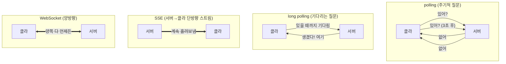

| 방식                         | 방향                     | 연결          | 오버헤드       | 적합한 곳                          |
| ---------------------------- | ------------------------ | ------------- | -------------- | ---------------------------------- |
| **polling**                  | 클라→서버 반복           | 매번 새로     | 큼 (헤더 반복) | 거의 안 씀                         |
| **long polling**             | 클라→서버 (대기)         | 응답까지 유지 | 중간           | WS 불가 환경의 **fallback**        |
| **SSE** (Server-Sent Events) | **서버→클라 단방향**     | 유지          | 작음           | 알림, 주식 시세, LLM 토큰 스트리밍 |
| **WebSocket**                | **양방향 (full-duplex)** | 유지          | 가장 작음      | 채팅, 협업 편집, 게임              |

**용어**

| 용어                      | 뜻                                                    |
| ------------------------- | ----------------------------------------------------- |
| **full-duplex**           | 양방향 동시 통신. WebSocket의 핵심 성질               |
| **half-duplex**           | 한 번에 한 방향                                       |
| **simplex**               | 단방향 (SSE가 이것)                                   |
| **push** vs **pull**      | 서버가 보냄 / 클라가 요청해서 가져옴                  |
| **head-of-line blocking** | 앞의 요청이 막히면 뒤가 전부 대기하는 현상            |
| **fallback**              | 주 방식이 안 될 때 쓰는 대체 수단                     |
| **graceful degradation**  | 기능이 안 되면 **덜 좋지만 동작하는** 상태로 내려가기 |

> **면접 답변 요지**: 채팅은 **양방향**이고 메시지가 **빈번**하다. SSE는 서버→클라만 가능해
> 송신에 별도 HTTP 요청이 필요하고, polling은 헤더 오버헤드가 크다.
> 따라서 **full-duplex**인 WebSocket이 맞다. 단, 프록시가 WS를 막는 환경에서는
> **long polling fallback**이 필요할 수 있다.

---

## 1~2단계: 핸드셰이크와 룸

### WebSocket 핸드셰이크 — HTTP로 시작한다

**가장 흔한 오해**: WebSocket이 HTTP와 완전히 별개라고 생각하는 것.
실제로는 **HTTP 요청으로 시작해서 프로토콜을 바꿔치기(upgrade)** 한다.

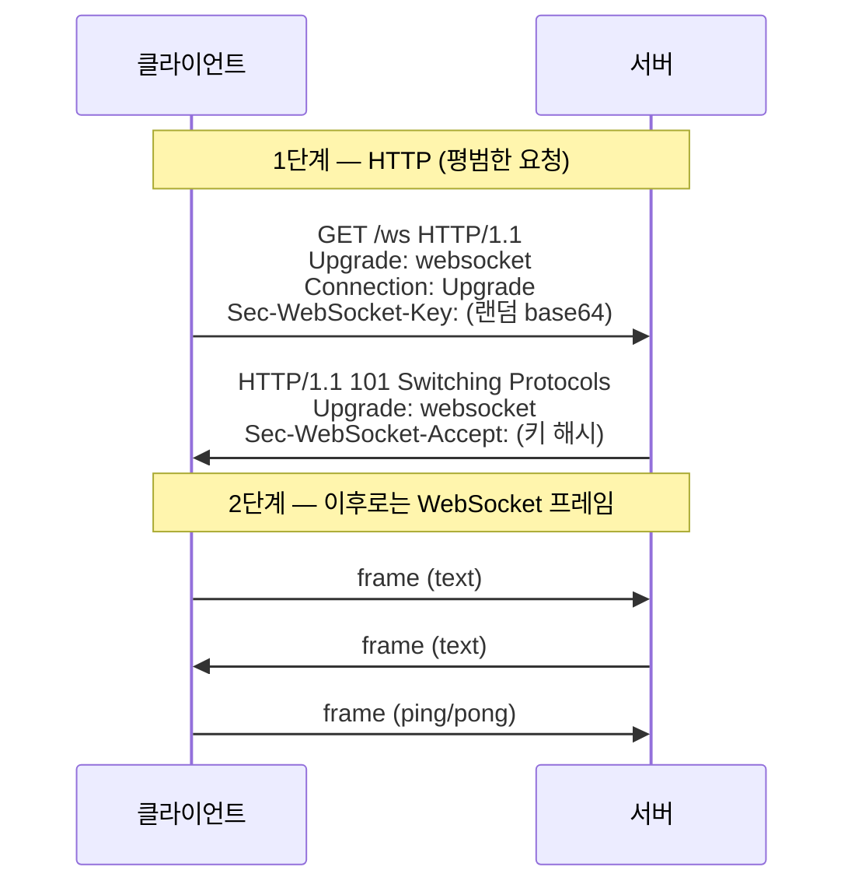

| 용어                                | 뜻                                                                    |
| ----------------------------------- | --------------------------------------------------------------------- |
| **handshake**                       | 연결 수립 절차                                                        |
| **HTTP Upgrade**                    | HTTP 연결을 다른 프로토콜로 전환하는 메커니즘                         |
| **101 Switching Protocols**         | upgrade 성공 상태 코드. **200이 아니다**                              |
| **`Sec-WebSocket-Key` / `-Accept`** | 캐시·프록시가 실수로 응답하는 것을 막는 검증 쌍                       |
| **`ws://` / `wss://`**              | WebSocket 스킴. `wss`는 TLS 적용 (= HTTPS의 관계)                     |
| **frame**                           | WebSocket의 전송 단위                                                 |
| **opcode**                          | 프레임 종류 (text / binary / close / ping / pong)                     |
| **masking**                         | 클라→서버 프레임은 **반드시 마스킹**해야 한다 (프록시 캐시 오염 방지) |

> **반드시 `wss://`를 쓴다.** `ws://`는 평문이라 중간에서 메시지를 다 볼 수 있다.

### 룸 / 채널

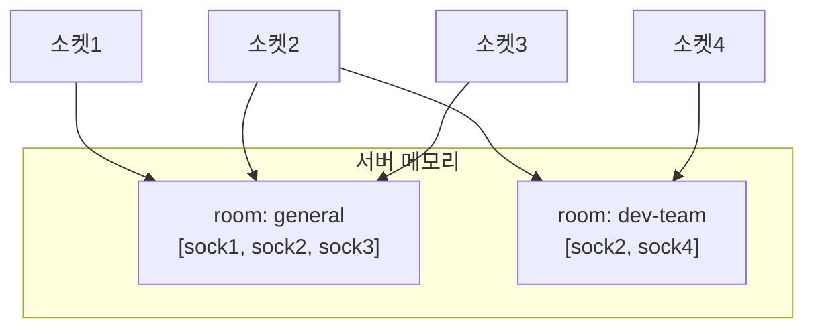

| 용어                               | 뜻                                                                |
| ---------------------------------- | ----------------------------------------------------------------- |
| **room** / **channel** / **topic** | 메시지를 받을 그룹 단위 (라이브러리마다 이름이 다름)              |
| **broadcast**                      | 룸의 **모든** 멤버에게 전송                                       |
| **fan-out**                        | 하나의 입력을 여러 수신자로 퍼뜨리는 것                           |
| **unicast / multicast**            | 1명에게 / 특정 다수에게                                           |
| **connection registry**            | 연결을 보관하는 자료구조                                          |
| **socket id**                      | 연결 하나의 식별자 (사용자 ID와 **다르다** — 한 사용자가 여러 탭) |
| **subscribe / unsubscribe**        | 룸 참여 / 이탈                                                    |

> **흔한 설계 실수**: 사용자 ID로 연결을 관리하는 것.
> 한 사용자가 **여러 탭·기기**에서 접속하므로 `userId → Set<socket>` 구조가 필요하다.

---

## 3단계: 하트비트와 재연결

### 죽은 연결 문제

TCP 연결은 **조용히 죽을 수 있다**(터널 통과, 와이파이 전환, 노트북 덮개 닫기).
서버는 `close` 프레임을 못 받으므로 **연결이 살아 있다고 착각한다.**

이것을 **half-open connection**(또는 **zombie connection**)이라 한다.

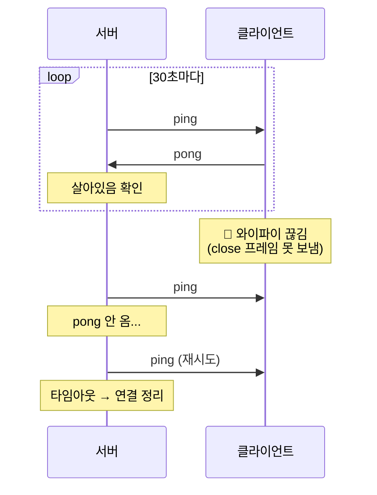

| 용어                              | 뜻                                                   |
| --------------------------------- | ---------------------------------------------------- |
| **heartbeat**                     | 주기적으로 생존을 확인하는 신호                      |
| **ping / pong**                   | WebSocket 프로토콜에 **내장된** 하트비트 프레임      |
| **keep-alive**                    | 연결 유지 메커니즘 (TCP에도 있지만 주기가 너무 길다) |
| **half-open / zombie connection** | 한쪽만 끊긴 줄 모르는 연결                           |
| **idle timeout**                  | 일정 시간 무응답 시 연결 종료                        |
| **liveness**                      | 살아 있는지                                          |
| **readiness**                     | 요청을 받을 준비가 됐는지 (liveness와 구분)          |

### 지수 백오프 + jitter

재연결을 **즉시·반복** 시도하면 서버가 죽는다. 특히 서버 재시작 시 **모든** 클라이언트가
동시에 몰려드는데, 이것을 **thundering herd**(쿵쾅대는 무리) 문제라고 한다.

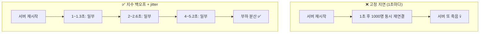

**실제 숫자로** (base 1초, 상한 30초, jitter 0~30%):

| 시도 | 기본 지연 (2^n)      | jitter 적용 후 범위 |
| ---- | -------------------- | ------------------- |
| 1회  | 1초                  | 1.0 ~ 1.3초         |
| 2회  | 2초                  | 2.0 ~ 2.6초         |
| 3회  | 4초                  | 4.0 ~ 5.2초         |
| 4회  | 8초                  | 8.0 ~ 10.4초        |
| 5회  | 16초                 | 16.0 ~ 20.8초       |
| 6회  | 32초 → **30초 상한** | 30.0 ~ 39.0초       |

| 용어                                                 | 뜻                                                      |
| ---------------------------------------------------- | ------------------------------------------------------- |
| **backoff**                                          | 재시도 간격을 늘리는 전략                               |
| **exponential backoff**                              | 지수적으로 늘림 (1→2→4→8)                               |
| **linear backoff**                                   | 일정하게 늘림 (1→2→3→4)                                 |
| **jitter**                                           | 지연에 **무작위 편차**를 더해 동시성을 깨는 것          |
| **full jitter / equal jitter / decorrelated jitter** | jitter 적용 방식들 (AWS 문서가 출처)                    |
| **cap** / **ceiling**                                | 지연 상한                                               |
| **thundering herd**                                  | 다수가 동시에 몰려 서버를 압도하는 현상                 |
| **retry storm**                                      | 재시도가 폭주하는 상황                                  |
| **circuit breaker**                                  | 실패가 계속되면 **일정 시간 시도 자체를 차단**하는 패턴 |
| **graceful reconnect**                               | 사용자가 거의 못 느끼게 복구하는 재연결                 |

> **jitter가 왜 필요한가**는 면접 단골이다. 답: 지수 백오프만 쓰면 **모든 클라이언트가
> 똑같은 타이밍에** 재시도해서 부하 집중이 그대로 유지된다. 무작위 편차로 **분산**시킨다.

---

## 4단계: presence

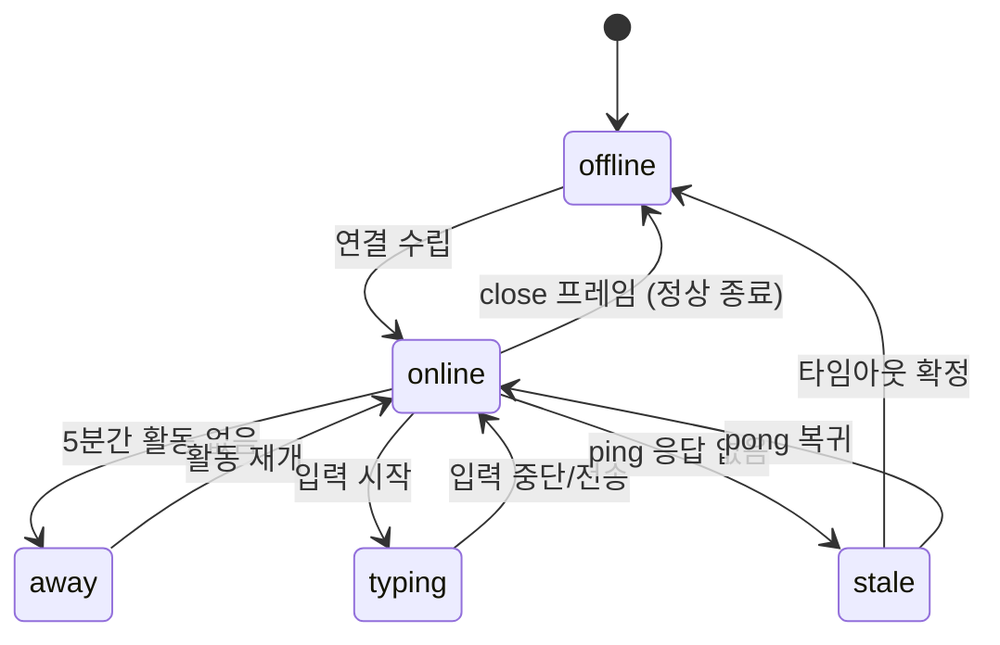

**핵심 난점**: 탭을 강제 종료하면 `close` 프레임이 오지 않는다.
그래서 **하트비트 타임아웃으로만** 판정할 수 있고, 그동안은 `stale` 상태다.

| 용어                              | 뜻                                                 |
| --------------------------------- | -------------------------------------------------- |
| **presence**                      | 접속·활동 상태                                     |
| **online / away / offline / DND** | 상태 종류 (Slack·Teams가 쓰는 구분)                |
| **typing indicator**              | "입력 중…" 표시                                    |
| **last seen**                     | 마지막 활동 시각                                   |
| **stale state**                   | 실제와 어긋난 낡은 상태                            |
| **TTL** (Time To Live)            | 상태의 유효 기간. 지나면 만료                      |
| **debounce**                      | 연속 이벤트를 **마지막 것만** 처리 (typing에 필수) |
| **throttle**                      | 연속 이벤트를 **일정 주기로만** 처리               |

> **debounce가 왜 필요한가**: 타이핑 중 키 입력마다 이벤트를 보내면 초당 수십 개가 된다.
> "입력 멈춘 뒤 300ms"에만 보내도록 **debounce**하면 트래픽이 수십 배 줄어든다.

---

## 5단계: 갭 복구 ⭐ (가장 깊게 갈 부분)

### 문제

재연결에 성공해도 **끊긴 동안 온 메시지는 받지 못했다.**

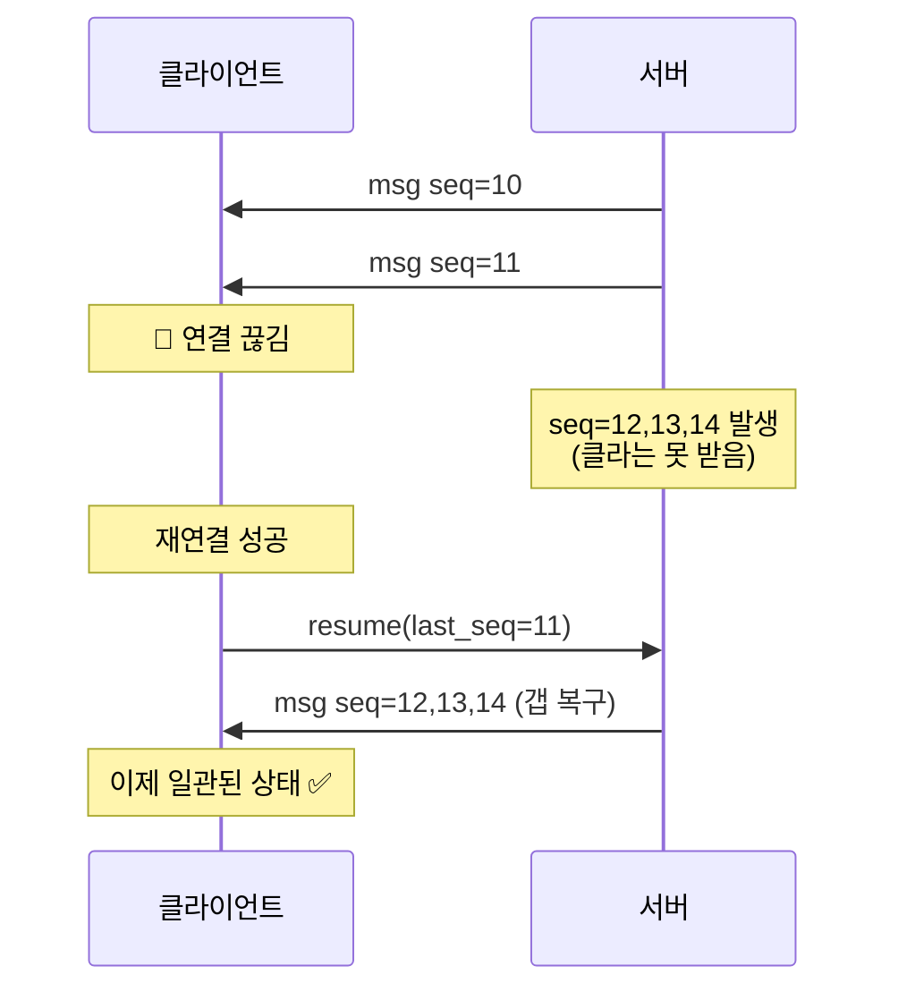

**핵심 아이디어**: 클라이언트가 **"내가 어디까지 받았는지"**(`last_seq`)를 기억하고,
재연결 시 그 지점부터 요청한다.

| 용어                                     | 뜻                                                    |
| ---------------------------------------- | ----------------------------------------------------- |
| **sequence number** (seq)                | 메시지에 붙는 **단조 증가** 번호                      |
| **monotonic**                            | 단조 증가 (되돌아가지 않음)                           |
| **cursor** / **offset** / **checkpoint** | "어디까지 읽었는지" 위치                              |
| **gap detection**                        | 번호가 건너뛴 것을 발견 (10, 11, **14** → 12·13 유실) |
| **backfill** / **catch-up**              | 놓친 데이터를 뒤늦게 채우기                           |
| **replay**                               | 지난 메시지를 다시 보내기                             |
| **message log**                          | 재전송을 위해 메시지를 보관하는 저장소                |
| **retention**                            | 로그 보관 기간 (영원히 보관할 수 없다)                |
| **watermark**                            | 처리 완료 지점 표시                                   |
| **session resumption**                   | 끊긴 세션을 이어받기                                  |

### 전달 보장 (delivery semantics) — 반드시 알아야 하는 3종

| 보장              | 뜻           | 결과                                         |
| ----------------- | ------------ | -------------------------------------------- |
| **at-most-once**  | 최대 한 번   | 유실 가능, 중복 없음                         |
| **at-least-once** | 최소 한 번   | **중복 가능**, 유실 없음                     |
| **exactly-once**  | 정확히 한 번 | 이상적이지만 분산 환경에서 **사실상 불가능** |

실무에서는 **at-least-once + 멱등 처리**로 exactly-once처럼 **보이게** 만든다.
이것이 6단계(멱등키)와 연결되는 지점이다.

| 용어                            | 뜻                                         |
| ------------------------------- | ------------------------------------------ |
| **ordering guarantee**          | 순서 보장                                  |
| **total order / partial order** | 전체 순서 / 부분(룸별) 순서                |
| **causal ordering**             | 인과 순서 (A가 B의 원인이면 A가 먼저)      |
| **eventual consistency**        | 최종적 일관성. 잠시 어긋나도 결국 수렴     |
| **split brain**                 | 양쪽이 서로 다른 상태를 정답이라 믿는 상황 |

---

## 6단계: optimistic UI와 멱등성

### 문제 — 중복 표시

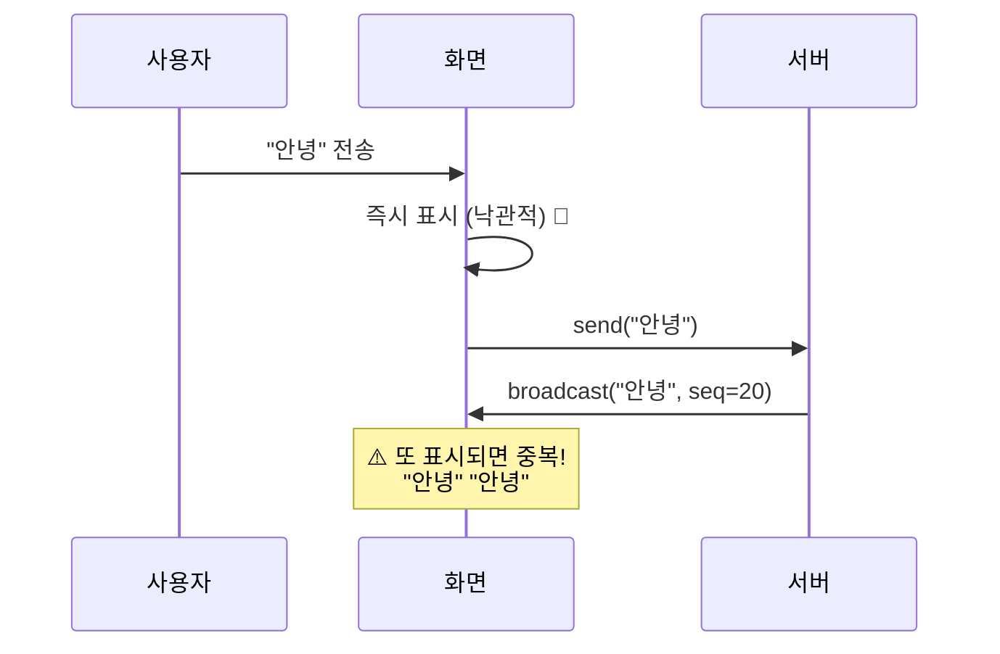

**해결**: 클라이언트가 보낼 때 **멱등키**(`client_msg_id`)를 붙이고,
서버 echo에 그 키가 실려 오면 **낙관적 항목을 교체**한다(추가하지 않는다).

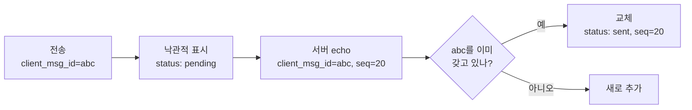

| 용어                                  | 뜻                                               |
| ------------------------------------- | ------------------------------------------------ |
| **optimistic UI / optimistic update** | 서버 응답 전에 **성공을 가정**해 먼저 그리기     |
| **pessimistic UI**                    | 응답을 기다린 뒤 그리기 (느리게 느껴짐)          |
| **idempotency**                       | 멱등성. **여러 번 해도 결과가 같은** 성질        |
| **idempotency key**                   | 중복 판별용 클라이언트 생성 키                   |
| **deduplication** (dedup)             | 중복 제거                                        |
| **reconciliation**                    | 낙관적 상태와 서버 상태를 맞추는 과정            |
| **rollback**                          | 실패 시 낙관적 변경을 되돌리기                   |
| **tombstone**                         | 삭제됨을 표시하는 마커 (실제 삭제 대신)          |
| **CRDT**                              | 충돌 없이 병합되는 자료구조 (협업 편집에서 쓰임) |
| **OT** (Operational Transformation)   | 편집 연산을 변환해 병합 (Google Docs 방식)       |

> `client_msg_id`는 **UUID**로 만든다. 서버가 번호를 주기 전에 클라이언트가
> 자기 메시지를 식별할 수단이 필요하기 때문이다.

---

## 7단계: 수평 확장 ⭐

### 문제 — 서버가 2대가 되는 순간 깨진다

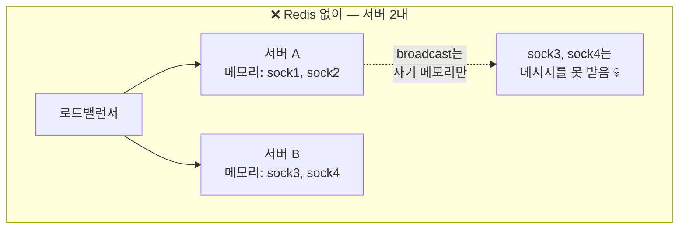

서버는 **자기 프로세스 메모리의 연결만** 알고 있다. A 서버에 붙은 사용자가 보낸 메시지는
B 서버에 붙은 사용자에게 **도달하지 않는다.**

### 해결 — Redis Pub/Sub

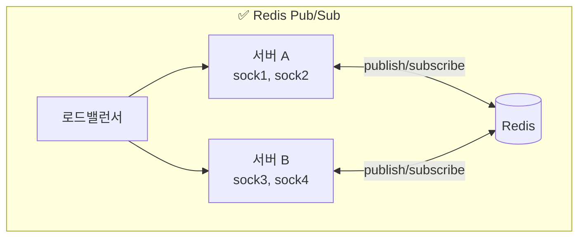

흐름: sock1이 메시지 전송 → 서버A가 Redis에 **publish** → 모든 서버가 **subscribe**로 수신
→ 각 서버가 자기 연결에 broadcast.

| 용어                                  | 뜻                                                                |
| ------------------------------------- | ----------------------------------------------------------------- |
| **horizontal scaling** (scale-out)    | 서버 **대수**를 늘림                                              |
| **vertical scaling** (scale-up)       | 서버 **성능**을 올림                                              |
| **stateless / stateful**              | 상태를 안 가짐 / 가짐. **WebSocket 서버는 본질적으로 stateful**   |
| **sticky session** (session affinity) | 같은 클라이언트를 **같은 서버로** 계속 보내기                     |
| **pub/sub**                           | 발행-구독 패턴                                                    |
| **message broker**                    | 메시지 중계자 (Redis, Kafka, RabbitMQ, NATS)                      |
| **fan-out**                           | 하나를 여럿에게 퍼뜨림                                            |
| **adapter**                           | 여러 서버를 묶는 계층 (Socket.IO의 `redis-adapter`가 이것)        |
| **shared state**                      | 서버 간 공유 상태                                                 |
| **single point of failure** (SPOF)    | 하나 죽으면 전체가 죽는 지점. Redis가 SPOF가 될 수 있다           |
| **at-least-once in pub/sub**          | Redis Pub/Sub는 **구독 중이 아니면 메시지를 잃는다** (보관 안 함) |

> **중요**: Redis **Pub/Sub**는 메시지를 저장하지 않는다. 구독자가 없으면 그냥 사라진다.
> 그래서 **갭 복구용 메시지 로그는 별도**(DB 또는 Redis Streams)로 둬야 한다.
> 이 둘을 혼동하면 "Redis 썼는데 왜 메시지가 유실되죠?"가 된다.

---

## 8단계: 보안

### CSWSH — WebSocket 고유 취약점

**가장 중요하고, 아는 사람이 드문 항목.**

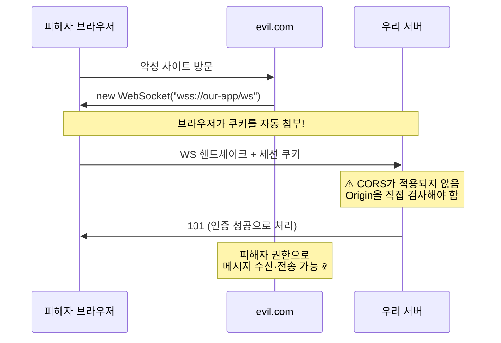

**핵심**: WebSocket 핸드셰이크에는 **CORS가 적용되지 않는다.**
`Origin` 헤더는 전송되지만 **브라우저가 막아주지 않으므로 서버가 직접 검증**해야 한다.

| 용어                                       | 뜻                                                               |
| ------------------------------------------ | ---------------------------------------------------------------- |
| **CSWSH** (Cross-Site WebSocket Hijacking) | 위 공격. CSRF의 WebSocket 버전                                   |
| **CSRF** (Cross-Site Request Forgery)      | 사이트 간 요청 위조                                              |
| **CORS**                                   | 브라우저의 교차 출처 제한. **WS 핸드셰이크에는 미적용**          |
| **origin validation**                      | `Origin` 헤더 **허용 목록** 검증. CSWSH의 기본 방어              |
| **SOP** (Same-Origin Policy)               | 동일 출처 정책                                                   |
| **CSP** (Content Security Policy)          | 로드 가능한 자원을 제한하는 헤더. `connect-src`로 WS도 제한 가능 |

### 그 외 보안 용어

| 용어                            | 뜻                                                                    |
| ------------------------------- | --------------------------------------------------------------------- |
| **authentication** (authn)      | **인증** — 누구인가                                                   |
| **authorization** (authz)       | **인가** — 무엇을 할 수 있는가                                        |
| **least privilege**             | 최소 권한 원칙                                                        |
| **defense in depth**            | 다층 방어                                                             |
| **rate limiting**               | 요청 빈도 제한                                                        |
| **token bucket / leaky bucket** | rate limiting 알고리즘                                                |
| **backpressure**                | 처리 능력을 넘는 유입을 **거슬러 막는** 압력                          |
| **payload size limit**          | 메시지 크기 상한 (없으면 메모리 고갈 공격 가능)                       |
| **XSS** (Cross-Site Scripting)  | 스크립트 주입. **남의 메시지를 렌더링하는 채팅은 표면이 넓다**        |
| **sanitization / escaping**     | 위험 문자 제거 / 무해화                                               |
| **DoS / DDoS**                  | 서비스 거부 공격                                                      |
| **slowloris**                   | 연결만 열어두고 느리게 보내 자원을 묶는 공격                          |
| **JWT**                         | 토큰 형식. **만료 처리**가 WebSocket에서 까다롭다 (연결 중 만료되면?) |
| **replay attack**               | 가로챈 요청을 재전송하는 공격                                         |

> **인증 시점 문제**: 핸드셰이크 때 토큰을 1회 검증하면, 연결이 몇 시간 유지되는 동안
> 토큰이 만료되거나 권한이 회수돼도 **그 연결은 계속 살아 있다.**
> 그래서 주기적 재검증이나 서버 주도 강제 종료가 필요하다. 10주차에 다룬다.

---

## 모니터링 (운영 관점, 보너스)

면접에서 "운영은 어떻게 하나요"를 물으면 쓸 어휘.

| 용어                       | 뜻                                                               |
| -------------------------- | ---------------------------------------------------------------- |
| **observability**          | 관측 가능성. **logs / metrics / traces** 3요소                   |
| **structured logging**     | JSON 등 **기계가 읽을 수 있는** 로그                             |
| **correlation id**         | 요청을 추적하는 공통 ID                                          |
| **SLI / SLO / SLA**        | 지표 / 목표 / 계약                                               |
| **p50 / p95 / p99**        | 지연 백분위. 평균보다 **p99가 중요하다**                         |
| **tail latency**           | 최악 구간 지연 (p99)                                             |
| **connection churn**       | 연결이 자주 생기고 끊기는 현상                                   |
| **concurrent connections** | 동시 연결 수. WebSocket 서버의 핵심 지표                         |
| **memory leak**            | 연결 해제 시 정리를 빠뜨리면 발생. **실시간 서버의 전형적 버그** |
| **alerting**               | 임계치 초과 시 알림                                              |
