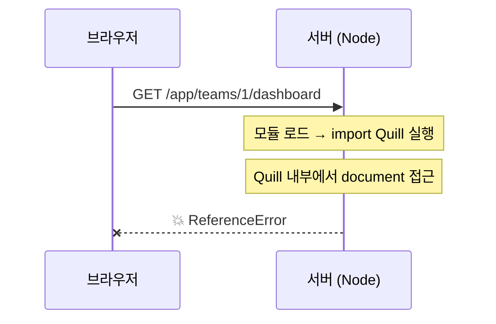

# SSR 환경에서 브라우저 전용 라이브러리 다루기

> 2026-10-14. `Editor`(Quill)의 동적 import 가 왜 필요한지 복기하면서 정리했다.
> 9주차 파일 업로드, 10주차 보안에서 같은 주제를 다시 만난다.

## 문제: 서버에는 `document` 가 없다

이 앱은 **SSR**(Server-Side Rendering)을 쓴다 (`react-router.config.ts` 의 `ssr: true`).
React Router 가 서버에서 HTML 을 먼저 만들어 보내고, 브라우저가 그걸 이어받는다.

그런데 서버는 **Node.js** 다. Node 에는 `document` · `window` · `localStorage` 가 없다.
브라우저에만 있는 것들이다.

Quill 은 **DOM 을 직접 조작하는** 라이브러리라, 평범하게 import 하면 서버에서 터진다:

```ts
import Quill from 'quill';

// ❌ 서버가 이 파일을 불러오는 순간 실행됨
// → ReferenceError: document is not defined
```



## 해결: 실행 시점을 미룬다

**동적 import** 는 "지금 불러오지 말고, 이 줄이 실행될 때 불러와라"는 뜻이다.

```ts
useEffect(() => {
  // useEffect 는 브라우저에서만 실행된다 → 안전
  import('quill')
    .then(({ default: Quill }) => {
      /* 여기서 에디터 생성 */
    })
    .catch((error: unknown) => {
      console.error('Quill 로드 실패:', error);
    });
}, []);
```

|           | 정적 import (파일 맨 위)      | 동적 import (`useEffect` 안)          |
| --------- | ----------------------------- | ------------------------------------- |
| 실행 시점 | 모듈 로드 시 = **서버에서도** | 호출될 때 = **브라우저에서만**        |
| 결과      | `document is not defined`     | ✅ 안전                               |
| 부수 효과 | 번들에 항상 포함              | **code splitting** — 필요할 때만 받음 |

마지막 줄이 보너스다. 동적 import 는 번들을 쪼개므로 에디터를 쓰지 않는 페이지는
Quill 을 다운로드하지 않는다.

## 이 프로젝트의 방어는 세 겹이다

`Editor` 하나에 세 가지 장치가 겹쳐 있다. 각각 다른 문제를 막는다.

| #   | 장치                           | 무엇을 막나                                                     |
| --- | ------------------------------ | --------------------------------------------------------------- |
| 1   | 파일명 `index.client.tsx`      | React Router 가 **서버 번들에서 제외**한다                      |
| 2   | `<ClientOnly>` (`remix-utils`) | 서버 렌더 시 `로딩 중...` 만 출력 → **hydration mismatch** 방지 |
| 3   | 동적 `import('quill')`         | 그래도 import 시점을 미뤄 **이중 방어**                         |

### `.client` / `.server` 규칙

React Router 는 파일명으로 경계를 강제한다:

- `*.client.tsx` → 서버 번들에서 빠진다
- `*.server.ts` → 클라이언트 번들에서 빠진다 (**비밀키·DB 접속이 브라우저로 새는 것을 막는다**)

→ WebSocket 클라이언트 코드는 `.client` 에, 서버 코드는 `.server` 에 둔다.
10주차 보안에서 API 키·세션 비밀을 다룰 때 이 경계가 핵심이 된다.

### hydration mismatch 가 뭔가

서버가 만든 HTML 과 브라우저가 처음 렌더한 결과가 **다르면** React 가 경고하거나 화면이 깨진다.
에디터는 브라우저에서만 존재하므로, 서버는 "없음", 브라우저는 "있음" 이 되어 불일치가 생긴다.
`<ClientOnly>` 는 **양쪽 모두 `로딩 중...` 을 렌더**하게 만들어 일치시킨 뒤,
마운트 후에 진짜 내용으로 교체한다.

## 함정: `useEffect(async () => ...)`

이번에 실제로 부딪힌 문제다. `await` 를 쓰려고 effect 콜백을 `async` 로 만들면 안 된다.

```ts
// ❌ cleanup 이 실행되지 않는다
useEffect(async () => {
  await import('quill').then(...);
  return () => {
    /* 정리 */
  };
}, []);
```

**이유**: `async` 함수는 무엇을 반환해도 **Promise 로 감싸진다.**
React 는 cleanup 함수를 기대하는데 Promise 를 받으므로 **cleanup 을 호출하지 못한다.**

```
의도:  useEffect → cleanup 함수 반환 → 언마운트 시 실행 ✅
실제:  useEffect → Promise 반환 → React 가 못 알아봄 → 정리 안 됨 ❌
```

`react-hooks/exhaustive-deps` 가 이걸 경고로 잡아준다:

> Effect callbacks are synchronous to prevent race conditions. Put the async function inside.

**올바른 형태** — effect 는 동기로 두고 내부에서 비동기를 처리한다:

```ts
useEffect(() => {
  // 방법 A: then/catch (지금 Editor 가 쓰는 방식)
  import('quill')
    .then(...)
    .catch((error: unknown) => console.error(error));

  // 방법 B: 내부 async 함수
  async function init() {
    const { default: Quill } = await import('quill');
    /* ... */
  }
  void init(); // floating promise 를 void 로 명시

  return () => {
    /* cleanup 정상 반환 */
  };
}, []);
```

> ⚠️ **실시간 작업에서 특히 중요하다.** WebSocket 연결도 effect cleanup 에서 끊어야 하는데,
> 같은 실수를 하면 **연결이 정리되지 않고 쌓인다.**
> 4주차 presence 의 "유령 연결"이 이 패턴에서 자주 나온다.

## 함정: 빈 `catch`

린트를 통과시키려고 에러를 버리면 안 된다.

```ts
.catch(_ => {});                                    // ❌ silent failure
.catch((e: unknown) => console.error('실패:', e));   // ✅ 최소한 보이게
```

빈 `catch` 는 **"안 되는데 에러도 없음"** 을 만든다. 디버깅에서 가장 괴로운 상태다.
규칙의 의도는 "에러를 처리하라"였는데 "에러를 버려라"로 답한 셈이 된다.

`error` 타입을 `unknown` 으로 두는 이유: catch 로 잡히는 값이 `Error` 가 아닐 수도 있다
(문자열이나 객체를 throw 할 수 있다). 그래서 `error instanceof Error` 로 좁혀서 쓴다.

> **실무 용어**: **silent failure**, **error swallowing**. 빈 catch 블록은
> 코드 리뷰에서 거의 항상 지적받는다.

## 체크리스트 — 브라우저 전용 라이브러리를 쓸 때

- [ ] 서버에서 실행되면 터지는 코드인가? (`document` · `window` · `navigator` 접근)
- [ ] 파일을 `*.client.tsx` 로 둘 수 있나?
- [ ] 서버/클라이언트 렌더 결과가 달라지나? → `<ClientOnly>` 필요
- [ ] import 를 `useEffect` 안으로 미뤄야 하나?
- [ ] effect 를 `async` 로 만들지 않았나? (cleanup 이 깨진다)
- [ ] `.catch` 가 에러를 버리지 않나?

## 용어

| 용어                            | 뜻                                                        |
| ------------------------------- | --------------------------------------------------------- |
| **SSR** (Server-Side Rendering) | 서버에서 HTML 을 먼저 만들어 보내는 방식                  |
| **hydration**                   | 서버가 보낸 HTML 에 브라우저가 이벤트·상태를 붙이는 과정  |
| **hydration mismatch**          | 서버 HTML 과 클라이언트 렌더 결과가 달라 생기는 오류      |
| **isomorphic / universal**      | 같은 코드가 서버와 브라우저 양쪽에서 도는 구조            |
| **dynamic import**              | `import()` — 실행 시점에 모듈을 불러온다. Promise 를 반환 |
| **code splitting**              | 번들을 쪼개 필요한 시점에만 내려받는 것                   |
| **silent failure**              | 실패했는데 아무 신호가 없는 상태                          |
| **error swallowing**            | 에러를 잡아서 버리는 것                                   |
| **fire-and-forget**             | 의도적으로 결과를 기다리지 않는 호출 (`void` 로 명시)     |
